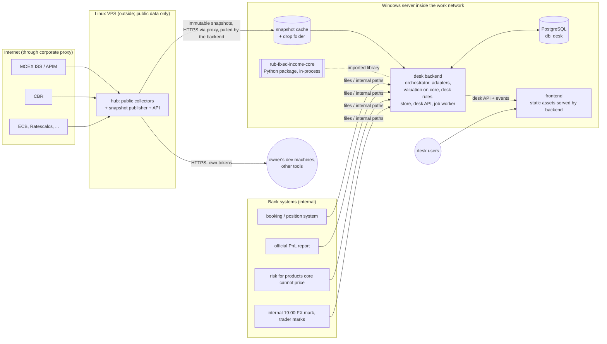

# 01 System overview

## 1 Purpose and scope

Trading Desk Monitor gives a RUB fixed-income desk one consistent view of:

- **Positions and valuation:** PV, clean/dirty prices, yields and spreads, by book, legal entity and issuer.
- **Risk:** key-rate DV01 by curve and bucket, CS01 and OFZ-spread risk, FX delta and OCP, JTD, and second-order (gamma, convexity, cross-gamma).
- **PnL:** a flash PnL at the market-FX basis, an explanation of it by component, and a comparison against official PnL at the CBR basis arriving on T+1.
- **Scenarios:**
  - preset shocks, historical worst windows, and interactive what-if shocks;
  - carry/funding horizon scenarios.
- **Funding and carry:** funding by position (POS/HTM) and by book (CASH/REPO), and OCP transfers. All of these follow `docs/ORG_CONVENTIONS.md`.
- **Intraday:** periodic refresh of PV, PnL and risk during the trading day.

**Out of scope for now:** VaR and limits, order entry, and automatic execution of OCP transfers. These are deliberately excluded (`docs/DATA_CONTRACT.md` §8). Keep room for them in the contracts.

**Scale assumption:** up to about 2,000 positions and a handful of users on one desk. Design for this, and do not add distributed infrastructure.

## 2 Components



| Component | Owns | Does not own |
|---|---|---|
| **Market data hub** | Raw source captures, normalized public market and static data, revisions and as-known reads, data quality and gaps, and immutable snapshot bundles | Curve building, cashflow projection, pricing, anything private to the desk |
| **Calculation core** | Instrument and market domain types, conventions, schedules, curves, pricing, sensitivities, exact scenario repricing | Network, files, databases, desk conventions (funding, OCP, official PnL), which data to use |
| **Desk backend** | Choosing which data to use and the override precedence; the wire → domain adapter; curve and projection builds through core; valuation runs; funding, OCP and HTM rules; PnL explain (later); run lineage; storage; jobs; the desk API | Collecting public data; the pricing math itself |
| **Frontend** | Presentation, interaction, filtering, the instant Taylor approximation while the user edits a scenario | Any number that is stored, shared, reported or reconciled ([03](03_CALCULATION_SPLIT.md)) |
| **PnL tool** | Parsing and analysing the bank's accounting PnL report | (Later) feeding official PnL to the backend through the `pnl_official` contract |

Key structural decisions:
- [ADR-001](adr/ADR-001-hosting-topology.md): desk on a Windows server inside the work network; one hub on a Linux VPS serves the desk and the owner's other consumers, each with its own token.
- [ADR-002](adr/ADR-002-materialized-market-snapshots.md): materialized market snapshots.
- [ADR-003](adr/ADR-003-adapter-in-backend.md): the wire → domain adapter sits in the backend.
- [ADR-004](adr/ADR-004-curves-built-in-backend.md): curves are built in the backend with core.
- [ADR-005](adr/ADR-005-calculation-split.md): calculation split.
- [ADR-006](adr/ADR-006-desk-store-postgres-bitemporal.md): desk store.
- [ADR-007](adr/ADR-007-repo-and-doc-layout.md): repository layout.

## 3 Hybrid valuation

Core 0.8.1 prices fixed-coupon RUB bonds, RUONIA / key-rate floaters (single-curve, without caps or floors) and FX futures. The book holds all products ([ROADMAP](ROADMAP.md) Q6): swaps, FX forwards, XCCY, CDS, linkers and more. The core development plan is `rub-fixed-income-core/docs/PRODUCT_ROADMAP.md`. The backend therefore runs a **hybrid valuation**:

| Product state | Source of PV and risk | Shown as |
|---|---|---|
| Supported by core | Computed by the backend with core | `computed` |
| Not yet supported by core | Imported from bank systems through contract 1.3 CSV or bundle | `imported`, with source and timestamp |
| Neither | Absent | `not covered`. Never a zero: totals show partial coverage `n/N` |

As core gains products, each one moves from `imported` to `computed`. For a transition period run both and reconcile them.

## 4 Main data flows

### 4.1 EOD run

```mermaid
sequenceDiagram
  participant H as hub
  participant B as backend orchestrator
  participant C as core (in-process)
  participant S as desk store
  H->>H: publish static + market snapshot (EOD cut)
  B->>H: fetch snapshot by id (verify sha256)
  B->>B: load private inputs (positions, trades, OTC terms, funding, cash, marks)
  B->>B: adapter: wire -> core domain; apply overrides
  B->>C: build curves (cached by snapshot, spec, bump, core version)
  B->>C: price + 1st/2nd-order risk + preset/historical exact scenarios
  B->>B: funding, OCP, HTM, carry projections (desk conventions)
  B->>S: write run (complete or failed, coverage, lineage)
  B-->>B: notify frontend (event: run published)
```

### 4.2 Intraday flash run (every N minutes during the session)

- **Inputs:** the latest intraday market snapshot, plus the positions as known at that time. If no intraday position feed exists, the opening book is used and the UI says so ([04](04_BACKEND.md) §6).
- **Recomputed every run:**
  - PV and first-order risk;
  - flash PnL against the previous EOD;
  - from M5, risk-based attribution. The default is greeks frozen at the previous EOD, pending DEC05.
- **Not recomputed:** the second-order Hessian is reused from the latest EOD and labelled with its age.
- Intraday runs are retained for the day and summarised. They never replace the EOD run.

### 4.3 T+1 official PnL

Official PnL arrives the next day from the bank (via pnl_tool's reader later). It is attached to the EOD run as an append-only revision. Coverage is shown as `n/N` positions or books. A missing official value stays missing; it is never zero, and never silently replaced by the estimate.

### 4.4 On-demand exact scenario

1. The user edits a scenario in the browser and sees the instant Taylor estimate (≈).
2. On request, or after a short idle debounce, the frontend posts the scenario definition.
3. The backend queues a job keyed by `hash(definition, run_id)`, revalues the base run exactly with core, stores the result, and emits an event.
4. The UI shows the exact number and its residual against the Taylor estimate. See [03](03_CALCULATION_SPLIT.md).

## 5 Honest current state (16 October 2026)

| Area | State | What it means for the plan |
|---|---|---|
| Hub collection | Mature: hundreds of tests (451 at `74ed84f`; growing); raw-first, fail-closed, never forward-fills | Build dispatch on top; do not redesign collection |
| Hub dispatch | `/v1` raw-row JSON and a TDM CSV export only. No snapshot IDs, no response models, no as-known reads for static data | [02](02_MARKET_DATA_AND_CORE_CONTRACT.md) work items |
| Core (0.8.1) | Clean pure kernel: fixed and floating RUB bonds (RUONIA / key-rate, point-in-time fixings, single curve, no caps/floors); FX futures; shared shocked OIS curves within a job; a versioned, hash-verified worker result contract.<br>Still missing: a domain snapshot / instrument model, holiday data, IRS on positions, FX forwards, XCCY, CDS, linkers | Core `docs/PRODUCT_ROADMAP.md` (from [07](07_CORE_PRODUCT_COVERAGE.md)) |
| Core ↔ hub | **No dependency.** Core's only bridge (`public_schedule.py`) targets the retired market-data-store | Replace with the adapter in the backend ([ADR-003](adr/ADR-003-adapter-in-backend.md)) |
| Backend | Contracts and conventions documented (contract 1.3). `tdm/` is a prototype store and read API with no calculation engine | [04](04_BACKEND.md) |
| Frontend | Mockups that define the screens; the calculations inside them are illustrative | [05](05_FRONTEND_INTEGRATION.md) |
| PnL | Standalone accounting-PnL tool | Connect later as the official-PnL source |

## 6 Cross-cutting principles

1. **Missing is not zero, stale is not unchanged, estimated is not official.** Two vocabularies, used everywhere:

   | Applies to | Values |
   |---|---|
   | A single value | `measured`, `zero` (a real zero), `missing`, `pending` (expected later, e.g. official on T+1), `stale`, `estimated`, `official` |
   | A position's valuation | `computed` (core), `imported` (bank system), `not covered` |
   | An aggregate | `complete` or `partial(n/N)` |

   Core's worker `Coverage` (`complete` / `partial` / `failed`) maps onto the aggregate states; `failed` positions become `not covered`. The hub already follows these rules. The backend and frontend must too.
2. **Every run is reproducible.** A run records the snapshot IDs, input hashes, override version, code versions and the run its greeks came from ([04](04_BACKEND.md) §3).
3. **Nothing is overwritten.** Corrections append revisions, for public data (hub), private data and attachments (backend) alike.
4. **One implementation per concept.** Desk conventions live once, in the backend. Pricing math lives once, in core. The browser approximation is a tested port, never a second source of truth.
5. **Develop outside, run inside.** Development uses public and synthetic data. Real positions and results exist only on the inside Windows server, never on the VPS ([06](06_DEPLOYMENT_AND_OPERATIONS.md)).
