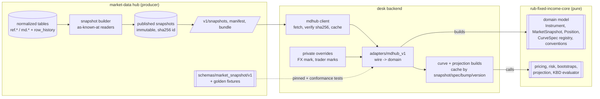

# 02 Market data and the calculation core: dependency and common contract

This document answers: **how does the calculation library get market and static data, and what common object contract should the market-data hub and the library share?**

Decisions:
- [ADR-002](adr/ADR-002-materialized-market-snapshots.md): snapshots.
- [ADR-003](adr/ADR-003-adapter-in-backend.md): adapter in the backend.
- [ADR-004](adr/ADR-004-curves-built-in-backend.md): curves and projections in the backend with core.

## 1 Current state (verified 16 October 2026)

**There is no dependency between core and the hub in either direction.**

| Fact | Evidence |
|---|---|
| Core does no I/O and has no `from_dict` for any type. It takes typed objects built by the caller. | `rub-fixed-income-core/docs/ARCHITECTURE.md`; `rub_fixed_income/*` |
| Core's only "market data" entry point validates the **retired** market-data-store response of `get_projected_bond_cashflows`. It requires `calculation_quality="exact_published"`, `formula_type` fixed, `financing_curve_build_id`, and per-row `coupon/principal/total/coupon_source`. | `rub_fixed_income/public_schedule.py:22` |
| That old service projected cashflows and built curves inside the data layer. | `rub-fixed-income-core/implementation/finlib/code/market-data-store/src/market_data_store/fixed_income.py:1863` (untracked evidence copy) |
| The hub has **no** projected-cashflow endpoint, no curve builds and no snapshot IDs. Its `DESIGN.md` non-goals exclude curve bootstrapping, projection, spreads and pricing. | `market-data-server/docs/DESIGN.md` §1 |
| Hub dispatch today: `/v1` JSON returning raw SQL rows (no response models; OpenAPI documents only parameters), plus the TDM 1.3 CSV export built on each call. | `market-data-server/src/mdhub/api/`, `src/mdhub/export/tdm.py` |
| As-known-at reads exist only for bond EOD (`md.bond_eod_known_at`, `md.bond_eod_yield_known_at`, `md.v_bond_eod_known_at`) and `md.fixing`. Static tables have history rows in `ops.row_history` (soft deletes via `is_deleted` are captured) but no as-known reader. `ref.calendar_day` and `ref.weekend_session` are hard-deleted on reload and so are not replayable. | migrations `0410_api_views.sql`, `0421_review2_fixes.sql`; `loaders/calendar.py` |
| Swap quotes carry no convention metadata: % p.a., tenor codes only. The quote-set type is the `dataset` column (`ruonia_ois`, `key_rate_swap`, …). | `md.curve_snapshot`, `md.curve_quote` |

So the owner's reading is correct: **the hub today is about collecting, not dispatching.** The work is to add a dispatch layer to the hub, a domain model to core, and an adapter in the backend.

## 2 Target layering

The core ↔ hub dependency is **indirect through the contract**, and **direct only from the backend**:
- core depends on nothing;
- the hub depends on nothing;
- the backend depends on core (Python import of a pinned release) and on the hub (HTTP, plus a pinned schema version).

## 3 Market Snapshot Contract v1 (outline)

The hub owns the normative JSON Schema. This outline fixes the **objects and their meaning** so that hub, adapter and core agree.

### 3.1 Envelope and manifest

| Field | Meaning |
|---|---|
| `snapshot_id` | sha256 of the canonical payload (sorted keys, UTF-8, decimals as strings) |
| `schema_version` | `market_snapshot/1.x` |
| `kind` | `static` or `market` |
| `cut_type` | `eod_preliminary`, `eod_final`, `intraday` |
| `business_date` | Moscow business date |
| `cut_ts` | UTC instant of the cut |
| `known_at` | UTC instant: no record learned after this is included |
| `static_snapshot_id` | `market` kind only: the static snapshot it is consistent with |
| `supersedes` | Previous snapshot ID for the same cut, if this is a correction |
| `sources[]` | Per-dataset source, run IDs, `fetched_at` range |
| `datasets[]` | Name, row count, sha256, coverage, stale flags |
| `excluded[]` | Records left out, with a reason (for example `coupon_type_unknown`, `perpetual_no_call_date`) |

**Rule:** a record is never silently dropped. It is either included with a quality label or listed in `excluded`.

**Naming:** the "hub column" notes in the tables below give the source column wherever the wire name differs from it.

**Collision to avoid:** the hub already has `ref.static_snapshot`, a per-SECID cache of source payload hashes. The published snapshots of [ADR-002](adr/ADR-002-materialized-market-snapshots.md) are a different concept. Give them a distinct table name (for example `ops.published_snapshot`) so the two are not confused.

### 3.2 Static snapshot objects

| Object | Key fields (units) | Source tables | Maps to core |
|---|---|---|---|
| `Instrument` | `secid` (primary id), `isin`, `regnumber`, `issuer_id`, `bond_class`, `coupon_type` ∈ {fixed, floating, indexed_face, zero, variable_known, unknown}, `face_unit`, `currency_id`, `initial_face_value`, `face_value` (current, per bond), `issue_date`, `maturity_date` (null for perpetual), `is_perpetual`, `is_amortizing`, `is_subordinated`, `coupon_frequency`, `day_count` (nullable; null means "not published") | `ref.bond`, `ref.bond_board` | `Instrument` terms (new, [07](07_CORE_PRODUCT_COVERAGE.md) package 0) |
| `CouponPeriod[]` | `coupon_no`, `start_date`, `pay_date`, `record_date`, `amount` (per bond, `face_unit`), `rate_pct` (hub `value_prc`), `face_value`, `status` ∈ {known, current_published, projected_by_moex, unknown} | `ref.bond_coupon` (non-deleted) | Coupon leg; only `known` is a fact ([ADR-004](adr/ADR-004-curves-built-in-backend.md) §3) |
| `Redemption[]` | `date`, `value_pct_of_initial`, `value` (per bond), `kind` ∈ {amortization, maturity} | `ref.bond_amortization` | Principal leg (coupon/principal split) |
| `Offer[]` | `offer_date`, `type` ∈ {put, call, buyback, unknown}, `status`, `window_start`/`window_end` (hub `offer_date_start`/`offer_date_end`), `price_pct` (hub `price`) | `ref.bond_offer` | Horizon choice (offer vs maturity) |
| `FloaterFormula` | `benchmark` (KEY_RATE, RUONIA, RUONIA_3M, …), `spread_bp`, `multiplier`, `lag_days`, `averaging`, `floor_pct`, `cap_pct`, `fixing_day`, `status` ∈ {curated, inferred, partial} | `ref.bond_rate_formula_resolved` | Floater coupon spec (package 1) |
| `Issuer` | `issuer_id`, `inn`, `name`, `sector`, `country`, `is_sovereign` | `ref.issuer` | Issuer reference (risk grouping, JTD) |
| `Calendar` | `calendar` ∈ {MOEX_STOCK, MOEX_FX, MOEX_FORTS, RU_PRODUCTION}, `valid_from`, `valid_to` (the covered range: outside it the calendar is unknown, never assumed Mon–Fri), `holidays[]` (weekdays with `is_business_day = false`), `working_weekends[]` (Saturdays/Sundays with `is_business_day = true`, i.e. transferred working days), `version`, `fingerprint` | `ref.calendar_effective` only. **Not** `ref.weekend_session`: those are MOEX trading sessions on non-settlement days and must not become business days | `BusinessCalendar(holidays, working_days, version)`; core rejects dates outside `valid_from`…`valid_to` |
| `IdMap` | `secid` ↔ `isin` ↔ `regnumber`, many-to-one flagged | `ref.bond` | Used by the backend to join private positions |

Static objects are read **as known at** `known_at`. That needs new hub readers over `ops.row_history` for `ref.*`; see the work list in §6.

### 3.3 Market snapshot objects

| Object | Key fields (units) | Source tables | Maps to core |
|---|---|---|---|
| `BondQuote` | `secid`, `board`, `trade_date`, all price bases as **separate labelled fields** (`close_pct`, `legal_close_pct`, `waprice_pct`, `market_price2_pct`, `market_price3_pct`, `admitted_quote_pct`; intraday: `bid`, `offer`, `last` with `ts`/`source_ts`), `accrued_per_bond`, `face_value`, MOEX analytics (`yield_*_pct`, `duration_days`, `zspread_bp`, `gspread_bp`) labelled `source_analytics`. EOD rows carry no observation time; their timing is the snapshot cut | `md.bond_eod` + `md.bond_eod_yield`; intraday `md.bond_quote_intraday` | `MarketObservation` (the price basis is chosen by the backend) |
| `CurveQuoteSet` | `quote_set_id` (hub `md.curve_snapshot.id`), `dataset` (hub code: `ruonia_ois`, `key_rate_swap`, `cny_ruonia_xccy`, …), `source`, `fetched_at`, `source_ts`, quotes[`tenor` (code), `tenor_months` / `tenor_days`, `pillar_date?`, `bid_pct`, `mid_pct`, `ask_pct`], `content_sha256` | `md.curve_snapshot` + `md.curve_quote` | `OisQuote` / `KeyRateSwapQuote` **after** the backend maps `dataset` → a core curve-spec ID, and the spec resolves tenor → maturity |
| `ZcycParams` | `trade_date`, `trade_time`, `is_eod`, `params{B1,B2,B3,T1,G1..G9}`, `standard_yields[]` (effective annual %), check error (bp) | `md.zcyc_snapshot` | KBD evaluator (package 0) |
| `Fixing` | `index_code`, `source`, `fixing_date` (observation), `effective_date`, `published_on`, `published_at?`, `value`, `unit` ∈ {pct, index}. One authoritative source per index (hub rule); other sources only when labelled | `md.fixing` (source is part of its key); RUSFAR from `md.index_eod` | Fixing history for floaters and funding; selection is point-in-time through the snapshot's `known_at` |
| `FxRate` (RUB rates) | `kind` ∈ {cbr_official, moex_eod, moex_indicative_14, moex_indicative_19}, `ccy` (indicative: from `ccy_pair`/`clearing`), `rate_rub_per_unit`, `effective_date`, `set_date` (CBR), `trade_time` (indicative) | `md.fx_official`, `md.fx_eod`, `md.fx_indicative` | FX context (packages 3–4); the desk FX mark is applied as a backend override |
| `CrossRate` (non-RUB) | `kind` = ecb, `base_ccy` = EUR, `ccy`, `rate_per_base`, `rate_date` | `md.ecb_fx` (`rate_per_eur`) | Cross rates only; never mixed into RUB FX |
| `CbrMeeting` | `meeting_date`, `effective_date`, `is_estimated`, `decision_rate_pct` | `ref.cbr_meeting` | Key-rate path segments |

### 3.4 Units and identity rules

| Rule | Detail |
|---|---|
| Decimals on the wire | Numbers are JSON strings carrying the exact stored `numeric` digits, or JSON numbers with the same digits. Never float-rounded. |
| Units in field names | `_pct` = percent, `_bp` = basis points, `_per_bond` = currency amount per bond. RUB FX is always RUB per 1 unit; non-RUB cross rates are separate objects with an explicit base currency. |
| Unit conversion | Happens **once**, in the backend adapter. Core receives decimals (`0.145`), prices as % of current nominal, amounts per bond. |
| Dates and times | Dates are ISO business dates (Moscow). Instants are UTC with offset. |
| Identifiers | `secid` is the primary instrument identifier (core already uses it). The ISIN is an alias via `IdMap`; it is not unique across SECIDs. Private positions keyed by ISIN are joined through `IdMap` in the backend, and ambiguous matches are reported, not guessed. |
| Quality | Every object carries a quality label or a coverage entry. Missing ≠ zero ≠ stale. |

## 4 Core domain model (to be added to core)

Specified in [07](07_CORE_PRODUCT_COVERAGE.md) package 0. In summary:

- **`Instrument`**: terms independent of any market:
  - identity;
  - currency and face (current and initial);
  - a coupon leg (fixed periods, or a floater formula with fixing rules);
  - a principal leg (redemptions);
  - offers/calls;
  - the calendar ID and conventions.

  It generates `Cashflow(date, coupon, principal, accrued_start, accrued_end)`. This replaces the total-only `BondCashflow`.
- **`MarketSnapshot`** (domain), shared by all positions:
  - curves by `curve_id` (built from `CurveSpec` + quote set, or a KBD evaluator);
  - fixings by index;
  - FX;
  - calendars by version;
  - `SnapshotEvidence` per input;
  - `snapshot_id`.

  It replaces the per-instrument `PublicBondSnapshot` that embeds its own curve.
- **`Position`**: `position_id`, `instrument_id`, signed quantity, book, accounting category (TRADING/HTM/REPO), currency, recovery for JTD.
- **`CurveSpec` registry**: versioned conventions per curve type:
  - day count;
  - fixed-leg frequency;
  - spot lag;
  - payment lag;
  - business-day convention;
  - floating-leg compounding/averaging;
  - interpolation.

  **Core owns the spec IDs** (for example `rub_ruonia_ois_moex_v2`, `rub_key_rate_swap_v1`, `rub_ofz_kbd_v1`). The backend adapter maps each hub `dataset` code to a spec ID through a versioned mapping table. Core never sees hub codes ([ADR-003](adr/ADR-003-adapter-in-backend.md)).
- **Serialization:** `to_dict`/`from_dict` for core's own types (needed for hashing, caching and fixtures). This is not a parser of the hub wire format.

## 5 Responsibilities at a glance

| Question | Answer |
|---|---|
| Who collects and versions public data? | Hub |
| Who decides *which* price, FX mark or curve to use? | Backend (adapter plus override precedence, recorded per run) |
| Who knows that MOEX "projected" coupons are not facts? | The hub labels them (`status`); the backend adapter interprets them; core projects its own |
| Who converts % to decimals and tenor codes to dates? | Backend adapter (units); core curve spec (tenor → maturity, with calendar) |
| Who builds curves and projects floater coupons? | Core math, invoked and cached by the backend ([ADR-004](adr/ADR-004-curves-built-in-backend.md)) |
| Who supplies holidays to core? | The hub calendar (in the static snapshot) → adapter → `BusinessCalendar` with a version and fingerprint |
| Who may compute public analytics such as Z-spreads for the whole universe? | The backend, as an optional job writing labelled analytics. Never written back as hub observations. |

## 6 Work list

**market-data-server (hub)**
1. Write `schemas/market_snapshot/v1/` (JSON Schema for §3) plus golden fixtures from public data: about 10 OFZ and corporates covering bullet, amortizer, put offer, floater and perpetual.
2. Add as-known-at readers for `ref.*` (bond, coupon, amortization, offer, formula, calendar) over `ops.row_history`. Replace the hard deletes in `ref.calendar_day` and `ref.weekend_session` (`loaders/calendar.py`) with versioned changes.
3. Add a snapshot builder and a published-snapshot table (for example `ops.published_snapshot`; not the existing `ref.static_snapshot`); publish static and market snapshots at EOD and on the intraday schedule; record a per-cut manifest.
4. Add endpoints: `GET /v1/snapshots?kind&cut_type&business_date&latest`, `GET /v1/snapshots/{id}/manifest`, `GET /v1/snapshots/{id}/bundle` (gzip, ETag = id).
5. Coverage fixes that apply to the snapshot as well as the TDM export:
   - include `coupon_type='unknown'` and perpetuals with labels;
   - only quote instruments that are in the static snapshot;
   - publish floater benchmarks verbatim with the formula status.
6. Add a single calendar version and fingerprint per snapshot.

**rub-fixed-income-core**
- Domain types, curve-spec registry, cashflow split, `to_dict`/`from_dict`, KBD evaluator.
- Deprecate `public_schedule.bind_market_data_store_schedule`.
- See [07](07_CORE_PRODUCT_COVERAGE.md) package 0.

**backend**
1. `mdhub` client: list, fetch, verify sha256, cache on disk, pin per run. Authenticates with its own hub bearer token (hub `MDHUB_API_TOKENS`), kept in the server's secret store.
2. `adapters/mdhub_v1`: wire → domain, overrides with precedence, `IdMap` join, units, and the versioned `dataset` → core curve-spec mapping.
3. Conformance tests: hub golden fixtures → adapter → core objects → prices, compared against stored expectations and MOEX-published accrued interest and yields.
4. Curve and projection build job with the cache ([ADR-004](adr/ADR-004-curves-built-in-backend.md)).

## 7 Testing the contract

- **Producer side (hub CI):** every published snapshot validates against the schema. The golden fixtures are regenerated only by a deliberate, reviewed change.
- **Consumer side (backend CI):** the pinned schema version and its fixtures run through the adapter and core. A schema bump without adapter changes fails CI.
- **Numerical anchors (core CI):** core keeps its **own** copies of public reference values (MOEX-published accrued interest, yields and durations, and KBD parameters with published yields). Core CI never checks out the hub. KBD yields must be reproduced from parameters (the hub already checks this within 0.01 bp).
