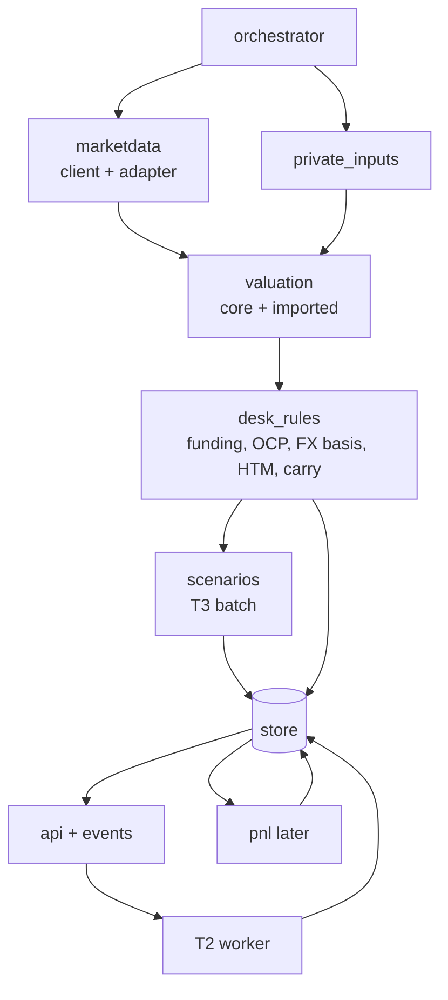

# 04 Desk backend

The desk backend is the heart of the system. It turns public snapshots, private desk data and the core library into published, reproducible runs, and serves them to the frontend.

Today it exists as:
- documents: `docs/DATA_CONTRACT.md` (contract 1.3), `ORG_CONVENTIONS.md`, `SCENARIOS.md`, `DATA_REQUIREMENTS.md`, `SERVICE_DATA_MODEL.md`;
- templates: `contract/`;
- a prototype store: `tdm/`.

## 1 Responsibilities

| Module (proposed package path) | Responsibility |
|---|---|
| `backend/orchestrator` | Schedules and runs the pipelines: EOD, intraday flash, T+1 official attach, historical scenario rebuild. One entry point per pipeline, with logs, a non-zero exit on failure, and notifications. |
| `backend/marketdata` | Hub client (list/fetch/verify/cache snapshots) and `adapters/mdhub_v1` (wire → core domain) per [02](02_MARKET_DATA_AND_CORE_CONTRACT.md). |
| `backend/inbox` (was `private_inputs`) | Ingestion of bank files ([ADR-008](adr/ADR-008-private-adapter-boundary.md), [08](08_PRIVATE_ADAPTER_INTERFACE.md)): folder watcher, SHA-256 ledger and archive, adapter loader (`DESK_PRIVATE_ADAPTER`), validation against contract 1.4 private schemas, bitemporal revisions (§2), events. Firm-specific parsing lives in the private adapter, not here; the reference adapter reads canonical CSV. |
| `backend/valuation` | Builds the per-run domain `MarketSnapshot` (curves, projections) through the curve cache; prices supported products with core; merges imported PV and risk for unsupported products; emits greeks in the desk factor format (`IR\|curve\|bucket`, `CS`, `FX\|ccy`). |
| `backend/desk_rules` | Desk conventions from `ORG_CONVENTIONS.md`: TRADING/HTM/DERIVS funding, CASH/REPO, OCP transfers, dual FX basis (market vs CBR), HTM treatment, carry/funding projections. **The only implementation of these rules in the system.** Open decisions (DEC01, DEC03, DEC06) are configuration, not code forks. |
| `backend/scenarios` | Scenario definitions (presets, historical, per-user), canonical hashing, T3 batch scenarios, the T2 job worker, and the reference Taylor engine ([03](03_CALCULATION_SPLIT.md)). |
| `backend/pnl` (later, M5) | PnL explain from runs T−1 and T, trades and cash events. The default uses attribution greeks frozen at T−1 EOD and a frozen attribution order; both are pending DEC05. Until M5, runs carry only flash PnL (change in value plus cash flows). Official PnL comparison and a break register (DEC12). Official PnL is the TradeLevel IFRS figure on the CBR basis, including funding (owner answer, Q8), fed by pnl_tool's TradeLevel reader. |
| `backend/store` | PostgreSQL `desk` database: runs, positions, results, attachments, private revisions, curve cache, jobs ([ADR-006](adr/ADR-006-desk-store-postgres-bitemporal.md)). The backend owns the schema, with versioned migrations (for example Alembic) in this repository. |
| `backend/api` | Desk API and event stream for the frontend ([05](05_FRONTEND_INTEGRATION.md)). The only client of the hub's API. |

## 2 Private data model: bitemporal, append-only

Every private record carries:

| Field | Meaning |
|---|---|
| `valid_date` | Business date the record describes |
| `recorded_at` | When the desk learned it (load time) |
| `source_file_sha256` | The loaded file |
| `revision` | Monotonic per (dataset, key, valid_date) |

Reading "positions for D as known at T" selects the latest revision with `recorded_at ≤ T`. Corrections append. The current `tdm` upserts (`pnl_official`, `ref_*`, snapshots replaced per as_of) are **not** ported as they are.

Effective-dated reference data (funding rules, OTC terms, private instrument overrides) also carries `effective_from`/`effective_to`. This fixes baseline review finding B02: today's funding spread must not be applied to a past date.

## 3 Run lineage

A run is immutable once published. It records:

| Lineage field | Purpose |
|---|---|
| `run_id`, `run_type` (EOD / INTRADAY / TEST / REPLAY), `business_date`, `cut_type` (eod_preliminary / eod_final / intraday), `cut_ts`, `supersedes_run_id` | Identity. The default view for a date is the latest complete EOD run on the `eod_final` snapshot, otherwise on `eod_preliminary`. A run on the final snapshot supersedes the preliminary one but does not delete it. TEST and REPLAY runs are never the default |
| `static_snapshot_id`, `market_snapshot_id`, snapshot `schema_version` | Exact public inputs ([ADR-002](adr/ADR-002-materialized-market-snapshots.md)) |
| `private_inputs_hash` and the `recorded_at` horizon | Exact private inputs (positions, trades, terms, funding, cash, marks) |
| `override_set_version` | Which overrides applied, with precedence |
| `curve_spec_registry_version`, `curve_build_ids` | How curves were built |
| `core_version` + git SHA, `backend_version` + git SHA | Code |
| `config_hash` | Desk-rule configuration (DEC-dependent settings) |
| `greeks_as_of_run` | For intraday runs: which EOD run supplied the Hessian and the attribution greeks |
| `coverage` | Per product and book: computed / imported / not covered, with `n/N` |
| `status` and log | loading → complete / failed. Orphaned "loading" runs are reaped |

Attachments to a run (official PnL, T2 scenario results, break notes) are separate append-only records with their own revision and author. A run never changes after it completes.

## 4 Desk conventions: one implementation

`desk_rules` holds every organisation-specific rule. The mockups and the `tdm` prototype each contain partial copies; this module replaces both:

- **Funding:**
  - POS/HTM by position;
  - CASH/REPO by book;
  - the previous-business-day clean MV base (DEC01; today `tdm/writer.py` uses current MV);
  - calendar-day rates;
  - basis by currency (DEC02).
- **FX:** market basis (internal ~19:00 mark, authoritative until DEC04 changes it) and CBR basis (correct effective date known at the cut; `tdm`'s `fx_cbr_next` picks the first future row, baseline review finding B08).
- **OCP:** transfer deals as real inputs; summary and residual.
- **HTM:** accrual treatment and risk exclusion.
- **Carry/funding projections:** frozen-portfolio horizon projections with key-rate paths per CBR meeting schedule. This is a synchronous endpoint for the frontend ([03](03_CALCULATION_SPLIT.md) §2).

Each rule has tests built from `ORG_CONVENTIONS.md` examples and the acceptance list in `docs/program/EXECUTION_SPEC.md` §11 (Friday-to-Monday accrual, rate changes effective Monday, holidays, new/closed/round-trip trades, counting exactly once).

## 5 Jobs

- **Queue:** a PostgreSQL table claimed with `SELECT … FOR UPDATE SKIP LOCKED` by one worker process. No Redis or Celery at this scale.
- **Job kinds:** `scenario_exact` (T2), `historical_rebuild`, `replay_run`, `analytics_universe` (optional public analytics).
- **Job record:**
  - `job_id`, `kind`, `definition_hash`, `base_run_id`;
  - `status` (queued / running / done / failed / cancelled);
  - `requested_by`;
  - timestamps, timeout, `error`;
  - `result_ref`.
- **Behaviour:**
  - identical `(definition_hash, base_run_id)` returns the cached result;
  - cancellation and timeout are honoured between positions;
  - progress is reported through the event stream.

## 6 Positions and trades: the open input

The design assumes the backend receives, from bank systems:
- the EOD position file per book;
- the trade feed;
- OTC terms;
- funding, cash and official PnL (T+1).

**Not yet known:**
- which booking system;
- how often it can be extracted;
- whether an intraday position or trade feed exists.

Consequences:
- **No intraday feed:** intraday runs reprice the opening book (positions as of the previous EOD plus any trades loaded so far). The UI states "opening book repriced", and intraday new-trade PnL is not attributed.
- **Intraday trade feed:** positions roll forward intraday (T−1 position + trades = current position), and new-trade PnL is attributed.
- **In every case:** reconcile the positions roll-forward at EOD (T−1 position + trades = T position) and report breaks.

Q1 is answered for the daily book (19 October 2026, [ROADMAP](ROADMAP.md) §4): a morning positions report as of 00:00, an OCP and cash report, the official PnL at T+1, and later trade exports every 1–2 hours, all through the private adapter ([08](08_PRIVATE_ADAPTER_INTERFACE.md)). Until the trade export exists, intraday is "opening book repriced".

## 7 Hybrid valuation

Core **0.32.0** (18 October 2026) has an engine for every product the book holds (Q6). What is missing is mostly on the data side: hub snapshot inputs, and term files for OTC products. The backend still uses only the bond engine (slices S1–S3). It moves to core's portfolio path in S4.

| Product | Core engine (release) | Inputs still missing | Backend status |
|---|---|---|---|
| Fixed-coupon RUB bonds (bullet, amortizing, puts) | `value_portfolio` over `Instrument`/`MarketSnapshot`/`Position` (0.10–0.11); KBD evaluator and G-spread (0.11); corporate accrual `RateAccrualCouponLeg` RATE_ACT_365 (0.17); MOEX goldens (0.15, 0.17) | none | `computed` since S1, via `BondRiskEngine` and the backend's own KBD module; moves to `value_portfolio` in S4 |
| Floaters (RUONIA, key rate, OFZ-PK), caps/floors, two curves | `floating` (0.8, 0.26) | Projection curves and fixings are in the snapshot; formula status per bond | S4 |
| Seasoned IRS (RUONIA OIS, key-rate swaps) | `swaps` (0.21); exchange OIS spec `rub_ruonia_ois_moex_v2` (0.22) | Trade terms (contract 1.3 OTC files) | S8 |
| Non-RUB bonds, FX delta | 0.18 | Foreign discount curves; FX spots with value dates | S8 |
| FX forwards and FX swaps | `fx_forwards` (0.19) | Trade terms; swap points or outrights | S8 |
| FX, RUONIA, key-rate and OFZ futures | `fx_futures` (0.8.1), `rate_futures`, `ofz_futures` (0.27) | Futures settlement prices and RUONIA index values in the snapshot | S8 |
| REPO | `repo` (0.28) | Trade terms; RUSFAR fixings (in the snapshot) | S8 |
| XCCY CNY/RUB vs RUONIA | `xccy` (0.25) | Trade terms; XCCY quotes (quote sets) | S8 |
| CDS | `cds` (0.24) | **No data source** for par spreads or upfronts | `imported` until a source exists |
| OFZ-IN linkers | `linkers` (0.23) | CPI series in the snapshot | S4 |
| Callables, perpetuals, constant-CPR pass-throughs | `callables`, `pass_through` (0.20), with explicit exercise or CPR assumptions | The desk's assumptions (DEC10) | S4 for perpetuals to call; the rest per DEC10 |
| Structured notes and other bonds without a usable schedule | none | — | `not covered`, or `imported` |

Carry, rolldown and theta of the whole mixed book: `horizon_portfolio` (0.14, 0.30–0.32). Derivatives return `rub-portfolio-risk-result.v3`; bond-only jobs keep v2 byte for byte (core `docs/portfolio-v3.md`). The backend stores and verifies these hash-verified results rather than inventing its own result shape for core output.

The `imported` path (contract 1.3 position, risk and gamma sections) stays for:
- products whose inputs are missing;
- the reconciliation period of each product. While a product is migrating, run both paths and publish the difference.

Status by package: `rub-fixed-income-core/docs/PRODUCT_ROADMAP.md`. Briefs: [briefs/CORE.md](briefs/CORE.md), [briefs/HUB.md](briefs/HUB.md).

## 8 Reuse from the `tdm` prototype

| Keep (semantics, maybe code) | Replace |
|---|---|
| Contract 1.3 datasets and validations (`tdm/datasets.py`, publish-time checks in `tdm/writer.py`) | SQLite store → PostgreSQL `desk` |
| Run lifecycle (loading → complete/failed), per-run copies of reference/market data | Upserts of private data → bitemporal revisions |
| Factor format `IR\|curve\|bucket`, `CS`, `FX\|ccy`; 11 buckets (`tdm/db.py`, matches core) | In-place mutation of published runs → attachments |
| Funding and OCP logic as a **starting point** for `desk_rules`, after reconciling with DEC01 | `md_*` series and linear pillar interpolation (`tdm/market.py`) → hub snapshots and core curves |
| Historical scenario construction (`tdm/histscen.py`) as a starting point | Zero-fill of missing data → coverage states |
| CLI commands as orchestrator entry points | `window.DESK` blob → desk API ([05](05_FRONTEND_INTEGRATION.md)) |

The baseline review findings B01–B12 (`docs/program/BASELINE_REVIEW.md`) and the BE-1…BE-10 findings in [reviews/2026-10-16_module_review.md](reviews/2026-10-16_module_review.md) serve as an acceptance checklist for the new backend.

## 9 Market history (R7, R24)

The charts' market past is a read model in the store, not a run input: runs read their pinned snapshots only. Two sources fill it:
- **the hub's history API** (hub 0.2.0, `/v1/history/*`, a token with scope `read`; `backend/src/desk/marketdata/hubhistory.py`): bond EOD from 2024-01-03 (the hub's first), the KBD, the curve quote sets the index lists (RUONIA OIS, key-rate swaps, CNY curves), fixings (key rate, RUONIA, RUSFAR, CPI) and FX, in a few columnar calls per month or year, revalidated by ETag (a 304 per unchanged chunk), resumable across autopilot cycles within a time budget, after the EOD runs;
- **the snapshots** (`history.py`): every cached `eod_final` bundle, and a few uncached ones per cycle when the hub has no history API (a hub before 0.2.0, or a token without `read`; the reason is shown in the settings page, `desk hub-check`, `desk history status` and the diagnostics).

A day's row is the history API's when it has one, else the snapshot's (views `md_bond_day`, `md_kbd_day`). The concept pages read it through two lazily loaded endpoints ([05](05_FRONTEND_INTEGRATION.md) §4b).
