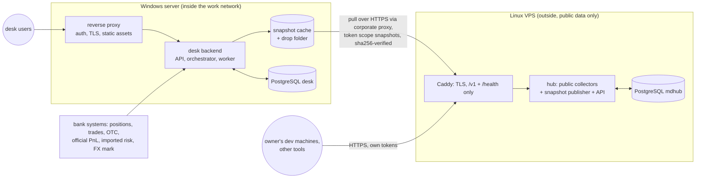

# 06 Deployment and operations

Decision: [ADR-001](adr/ADR-001-hosting-topology.md).
- The desk backend and frontend run on a **Windows server inside the work network**.
- The market-data hub runs as **one instance on a Linux VPS** and serves several consumers: the desk backend, the owner's development machines and other tools, each with its own token.
- Immutable snapshots are the only thing that crosses the boundary, and only inwards.

## 1 Topology

**Rules:**
- No private data on the VPS. Consumers only read from the hub; nothing is written to it from inside.
- The backend reads market data only from its snapshot cache, so a VPS or proxy outage never blocks a run. Snapshots already in the cache are used, and their age is shown.

## 2 Windows server layout (inside)

| Process | Runs as | Bind | Notes |
|---|---|---|---|
| Reverse proxy (IIS or Caddy) | Windows service | Internal HTTPS port | Authentication (Windows Integrated Authentication if allowed), TLS, static frontend assets, SSE without buffering |
| Desk backend API | Windows service (WinSW or NSSM wrapping Uvicorn) | localhost | FastAPI |
| Desk orchestrator and T2 worker | Windows service + Task Scheduler for the EOD and intraday triggers | — | One worker process with a process pool for valuation (Windows `spawn` start method) |
| Snapshot cache | Part of the backend worker | — | Pulls new snapshots from the VPS hub, verifies sha256 against the ID, stores the bundles; also ingests the drop folder |
| PostgreSQL 16 (Windows build) | Windows service | localhost | Database `desk` only |

**Python on Windows:** pinned to **3.11** (the version available on the work machine).
- Core requires ≥3.11, so it fits.
- The hub does not run on Windows, so its ≥3.12 requirement does not matter here.

**Sizing envelope** (to be measured): 4–8 cores, 16 GB RAM, SSD sized for snapshots and the desk database.

## 3 Linux VPS layout (outside)

**Deployed 18 October 2026**, hub 0.1.0. The address is not kept in the repository: each consumer sets it in its own settings (`DESK_HUB_URL` for the backend). The snapshot layer and consumer tokens are still to come ([VERTICAL_SLICES](VERTICAL_SLICES.md) S3, H1–H5).

- Reuse the hub's existing deploy (`market-data-server/deploy/README_DEPLOY.md`): docker compose (or systemd), PostgreSQL 16, Python 3.12, Caddy for TLS.
- Sizing: the deploy guide's minimum is 4 GB RAM and an 80 GB SSD. The seed database is already 3.4 GB, so leave headroom (8 GB RAM, 100 GB or more).
- Firewall: only 22 and 443 open (80 for the HTTP certificate challenge). PostgreSQL and the API bind to 127.0.0.1; Caddy proxies only `/v1/*` and `/health/*`.
- **Consumers and tokens.** One named token per consumer, with the narrowest scope (`snapshots` for the desk backend; `read` for development machines and analysis tools). Tokens are revocable in the admin console, and every request is logged per token.
- The admin console is reachable only through Caddy and the IP allow-list, with passkey or TOTP login.
- **Location.** Prefer a provider and region from which every public source answers. cbr.ru, Rosstat and MOEX restrict some foreign IP addresses at times, and Cbonds allow-lists client IPs. Check with the hub's source probes before restoring the seed.
- Backups of the VPS database go off the VPS (program ADR07, hub README_DEPLOY §7). `deploy/.env` is backed up separately, because it holds the key that opens the stored source credentials.

## 4 Which collector runs where

| Source kind | Where it enters |
|---|---|
| Public sources (MOEX ISS/APIM, CBR, ECB, Rosstat, Ratescalcs, OTC Monitor) | The VPS hub. It is the single authoritative location of every series it collects |
| Bank-internal sources (internal FX mark, internal market-data system, vendor feeds licensed to the bank network) | The desk backend's private-input adapters inside ([04](04_BACKEND.md)). They are versioned overrides on top of a hub snapshot and are never sent to the hub |
| Snapshot bundles copied by hand (fallback when the proxy blocks the VPS) | The backend's drop folder inside, with the same sha256 verification |

A run's lineage records the hub snapshot IDs and the override set version, so which data came from where is always visible.

## 5 Corporate proxy (open: Q4)

The backend's snapshot cache needs outbound HTTPS to the VPS hub through the proxy. Its behaviour is still unknown, so plan for:
- **TLS inspection.** Install the bank root CA into the service trust store (`SSL_CERT_FILE` / `REQUESTS_CA_BUNDLE`, or the httpx `verify` setting). **Never disable certificate verification.**
- **Proxy authentication.** NTLM/Kerberos may need a local helper (px, cntlm) or a service account allowlisted by host.
- **An allowlist request:** the VPS hub's hostname only.
- **A fallback.** A drop folder where an operator places snapshot bundles fetched elsewhere. They are ingested with the same verification, and staleness is shown in the UI.

## 6 Data licensing

All market data used is properly licensed (owner, 16 October 2026). Record each source's licence scope in the hub's source registry, and keep the authoritative source per series (DEC04). The hub serves several consumers, so tokens go only to the owner's own consumers within each source's licence scope.

## 7 Develop outside, run inside

| Rule | How |
|---|---|
| No real positions, results or internal files leave the network | Development uses public data and synthetic portfolios only |
| Fixtures are public or synthetic | A CI check rejects private identifiers (book names, counterparty names, internal IDs) in `fixtures/` and test data |
| Reproducible installs without internet | Build an offline **Windows wheelhouse for Python 3.11** outside (numpy and psycopg binary wheels included), transfer it with checksums, install pinned versions. Test on Windows before each release (program ADR08) |
| Versioned releases | Core released with tags; backend pins the exact core version; hub schema version pinned in the backend |
| Code transfer | Git bundle or internal mirror, plus a release archive with checksums |

### 7.1 Releases and the in-app updater

The work machine updates itself from **GitHub Releases** of this (public) repository. The owner's situation: the Windows work PC sits behind a corporate proxy; the standard `gh` tooling cannot download from GitHub there, the browser can. So the updater tries the server's own paths first and falls back to the browser, and shows which path works.

**Publishing.** `.github/workflows/release.yml` runs on a tag `v<backend version>` (`backend/pyproject.toml`; `backend/tools/release_assets.py check-tag` refuses any other tag, so every release bumps the version that `desk.update.compare` orders by). It runs lint and tests, builds the bundle with `build_windows_bundle.py` (and patches: `--patch-base` = the previous release's full zip as published, downloaded and checked against its `SHA256SUMS`, and `--patch-from-delivered` = the newest record in `backend/tools/delivered/`, what the owner actually got outside the releases) and publishes `DeskMonitor-<version>.zip`, `DeskMonitor-patch-<old>-to-<new>.zip`, `SHA256SUMS`, `release.json` (version, commit, core pin, every zip with size and SHA-256) and notes that repeat the checksums. No secrets: core is public and pinned in the bundle's wheelhouse; **the private adapter is never in a public release** (the tool refuses a zip with `adapter/` or `-with-adapter`), and installing a release keeps the installed `adapter\`.

**Check** (`desk.updater.service`, routes `/api/v1/update/remote*`, local only like §05.6's settings routes). The server asks `https://github.com/<repo>/releases/latest/download/release.json` — no API, no rate limit, the same hosts as the download — and falls back to the API (`/repos/<repo>/releases/latest` plus `SHA256SUMS`). Three server layers, auto-selected (the last one that worked first; `update_transport` forces one):

| Layer | TLS trust | Proxy | Proxy login |
|---|---|---|---|
| `python` (urllib) | OS store via `truststore` | `HTTPS_PROXY`, Internet Options, else the PAC/WPAD answer of Windows (`GetSystemWebProxy`) | Basic only (settings' proxy login) |
| `curl` (`System32\curl.exe`) | Schannel = Windows store | same as `python` | SSPI: NTLM/Kerberos/Negotiate as the current Windows user |
| `powershell` (`Invoke-WebRequest`, .NET) | Windows store | system proxy and PAC, like the browser | `DefaultNetworkCredentials` (current user) |

Every failure is classified (`desk.updater.net.CODES`): `tls_untrusted` (a TLS-inspecting proxy whose root CA is not in the Windows store), `tls`, `proxy_auth` (407, with the schemes the proxy asks for), `proxy_denied` (CONNECT refused, or a 403 that is not GitHub's own answer), `dns`, `connect`, `timeout`, `rate_limited`, `not_found`. When no layer gets through, the **page** asks `api.github.com` itself and posts the JSON to the server, which parses and checks it as its own. A page opened in the Windows bundle starts a check when the last is older than 6 hours (1 hour after a failure); the navigation bar then shows «Новая версия …».

**CORS, verified** (22 Oct 2026, a real Chromium page on `http://127.0.0.1`): `api.github.com` answers `Access-Control-Allow-Origin: *`, so a simple `fetch` (GET, only `Accept`, no credentials: no preflight) of the latest release works and its assets carry `digest: "sha256:…"`. Release **downloads** do not: `github.com/<repo>/releases/download/…` answers 302 without CORS headers, and the API asset endpoint (`Accept: application/octet-stream`) redirects to `release-assets.githubusercontent.com`, which has none either. So the browser never `fetch`es a zip; it downloads it as a normal navigation.

**Install.** `release.choose` picks a patch made from exactly the installed version, else the full zip; a version that is not newer only with an explicit `allow_downgrade` (the settings page's own install route enforces the same). The checksum is mandatory: `release.json`, `SHA256SUMS`, the notes and the API `digest` must agree where present, and a zip without any is refused. If the server's check worked, the server downloads (into `<home>/updates/downloads`, then `uploads`), verifies size and SHA-256 and installs through the existing pipeline (`desk.update.stage` → launcher, which backs up, restarts and rolls back a version that does not answer). Otherwise — or after every layer failed or delivered other bytes — the page starts a browser download of the asset's github.com address and the server watches the downloads folder (`update_downloads_dir`, default the Windows known folder Downloads from the registry) for `name.zip` / `name (1).zip`, verifies it and installs it; the owner's file stays where the browser saved it. A patch that does not fit the installed files falls back to the full zip (same checksum rules). Fallbacks: «Найти в «Загрузках»» (a zip and `SHA256SUMS` saved by hand from the release page) and the existing upload (the zip dropped onto the section, or «Загрузить zip с компьютера»). **Rollback:** the launcher keeps the replaced files of the last three updates (`updates\backup\<old>`); «Вернуть <old>» stages them as an update back (`desk.update.stage_rollback`).

**Patches and builds.** The interim 0.2.1 patch was refused although the installed version string was its base: the base had been *rebuilt*, and a rebuild of one commit was not byte-identical (pip's wheel cache returned a core wheel built under another `SOURCE_DATE_EPOCH`; build backends floated; file modes followed the checkout's umask). Since then: (1) builds are reproducible — our wheels by `uv build` with pinned backends (`backend/tools/bundle-build-constraints.txt`), `SOURCE_DATE_EPOCH` from the commit that last changed each package (core: its pinned commit), rewritten in one form (sorted, fixed time and modes, stored); the zips with fixed times, order and modes; each build compares a second build of our wheels; (2) a patch is made against what was delivered — the published release asset or a `delivered/` record (`--record-delivered`), and against every known build of its base version at once; (3) the base check is by content: only the files a patch does not ship must match, the message names both build ids (`build_id`, the sha256 of the manifest outside `adapter/`), the file and both hashes, and the GitHub updater installs the full zip instead; (4) the with-adapter bundle is the public bundle plus `adapter/` (written together, or `--from-bundle` from a published zip, checked byte for byte), and patches never ship, delete or list `adapter/`.

**Private artifacts: the adapter** (owner's decision 29.10.2026, TDM#427; DECISIONS DEC14). The adapter repository (`trades-data-adapter`) is private, so its releases are read with a **GitHub token kept on the work machine**: a fine-grained personal access token for that one repository, permission *Contents: Read-only*, with an expiry. It is stored like the hub token: `DESK_GITHUB_TOKEN` (environment or env file) else `<home>/github_token`, written by the settings page (`PUT /api/v1/settings/github-token`, an empty value removes it; 0600 on POSIX), never returned (only `github_token_set` and its source), never logged, scrubbed from diagnostics. Core still reaches the machine inside the public monitor release.

*Publishing* (the adapter repository's release workflow, contract format 1): a tag `v<tda.__version__>` publishes exactly `tda-adapter.zip` (the package under `src/<name>/`, `README*`, and `ADAPTER_RELEASE.json`: name, version, SPI, contract, commit, the package path and the SHA-256 of every other member), `adapter-release.json` (version, tag, commit, the zip's size and SHA-256) and `SHA256SUMS` of both. Fixed names, so a signed-in browser finds `https://github.com/<repo>/releases/latest/download/tda-adapter.zip`.

*Check and download* (`desk.updater.adapter`, «Обновление адаптера» in the settings page's adapter section, routes `/api/v1/update/adapter*`, admin only like the other update routes). Through the same three server layers, with `Authorization: Bearer <token>` sent **only to `https://api.github.com/`** (refused for any other URL before a request): `GET /repos/<repo>/releases/latest`, then the assets by `GET /repos/<repo>/releases/assets/<id>` with `Accept: application/octet-stream`, which GitHub answers with a 302 to its file storage (`release-assets.githubusercontent.com` / `objects.githubusercontent.com`). The token never follows that redirect: `python` sends it as an unredirected header and its redirect handler re-adds it only for `https://api.github.com/`; `curl` gets it in the `-K` config file (never on the command line) and is used with a token only from 7.58, which drops a custom `Authorization` on a cross-host redirect (CVE-2018-1000007); `powershell` gets it in the child's environment, never in the script, and .NET Framework's `HttpWebRequest` (Windows PowerShell 5.1) clears `Authorization` on every automatic redirect. A 401 is `token_rejected` (expired, revoked, mistyped: create a new token), a 404 with the token is `no_access` (the token lacks this repository, or no release yet). The zip's SHA-256 must agree between `adapter-release.json`, `SHA256SUMS` and the API's `digest`. **Browser fallback:** without a token, or when every layer fails, the page starts an ordinary browser download of the release's `tda-adapter.zip` on github.com (the owner is signed in to GitHub there) and the server watches the downloads folder for `tda-adapter.zip` / `tda-adapter (N).zip` written after the click; also «Найти в «Загрузках»» and dropping the zip onto the block.

*Install* — only on the owner's click, never automatically, and never with a pinned `private_adapter_sha256`: the zip is checked strictly against its inner manifest (every member listed with its SHA-256, nothing extra or missing, safe relative paths, no links or encryption, size limits, exactly one top-level package), unpacked into `<home>/adapter-releases/<version>/` (the package at `<version>/<name>/`, plus the README files and `ADAPTER_RELEASE.json`) through a temporary folder and a rename, loaded by the monitor's own loader (an adapter for a newer contract or SPI is refused: update the monitor first), and only then `current.json` (`version`, `package`, `previous`, `installed_at`, `source`, `sha256`) is switched atomically and the loaded handles are dropped. No restart: the settings are re-read on every request and cycle, and every adapter call runs in a fresh child process. Only a newer version than the one in use is offered unless confirmed. The newest three version folders are kept (never the current or the previous). «Вернуть <previous>» switches `current.json` back; «Использовать адаптер из комплекта» removes it. Installs and rollbacks go to `logs\update.log`.

*Which adapter runs* (`desk.settings`, `private_adapter_source`): an explicit `private_adapter` (environment, settings.json, env file) always wins — the page then says the installed release is not used until the field is cleared; else the installed release when the bundle has no adapter or the bundle's adapter (`__version__` of its package) is not newer; else the bundle's; else the reference adapter. So a new monitor bundle that ships a newer adapter takes over, and an adapter update no longer needs a new monitor version. The with-adapter bundle built at home stays possible (the first install, or a machine without any GitHub access).

**What to tell IT if the server layers fail** (the diagnostics table on the settings page shows each layer × host): allow `github.com`, `api.github.com`, `release-assets.githubusercontent.com` and `objects.githubusercontent.com` on 443 (the adapter's releases use the same hosts: `api.github.com` with the token, the file storage without it) for the programs `python.exe` (in the bundle), `C:\Windows\System32\curl.exe` and `powershell.exe`; put the TLS-inspection root CA into the Windows trusted root store (or exempt these hosts from inspection); let the proxy accept NTLM/Kerberos from non-browser clients or exempt these hosts from authentication. Nothing of this is required: the browser path works without IT.

## 8 Time

- Store instants as `timestamptz` in UTC. The business date is Moscow (UTC+3, no daylight saving).
- The Windows server clock and the VPS clock are both synchronised (NTP). Cut times are compared in UTC.
- **EOD cut:** which session close or mark defines EOD for bonds, curves and FX is decision DEC04. Until it is settled:
  - bonds use the MOEX main-session EOD (preliminary) and the next-morning final;
  - FX uses the internal 19:00 mark when supplied, otherwise it is labelled as a candidate;
  - CBR FX uses the effective date known at the cut.
- **Calendars:** the hub's calendars, including Russia's transferred working Saturdays, reach core only through the versioned calendar in the static snapshot.

## 9 Monitoring and alerting

The hub has quality checks and gap tracking but **no alerting** today. Add one notification channel (email or the bank messenger) for:

| Source | Alert |
|---|---|
| Hub (VPS) | Failed or missed job; dataset stale beyond policy; gap turned unfillable; snapshot not published at the cut; source probe failing; certificate expiry |
| Snapshot cache (inside) | Newest cached snapshot older than the cut plus a grace period; pull failing (proxy or token) |
| Backend | EOD or intraday run failed or incomplete; coverage below threshold; T+1 official not attached by a set time; PnL break above threshold (DEC12) |
| Servers | Disk usage, backup failure, certificate expiry, service down |

Health endpoints: hub `/health/ready`; backend `/health/ready` (database, latest cached snapshot age, worker heartbeat).

## 10 Backups and recovery

| Item | Method | Target |
|---|---|---|
| `desk` database (inside) | Nightly `pg_dump -Fc`, plus WAL archiving if RPO < 24 h is required | A backup location inside the bank, **not on the same disk** |
| Snapshot cache (inside) | Not backed up: it can be pulled again from the hub by ID. Snapshots used by official runs are kept for replay | — |
| VPS `mdhub` and raw archive | Nightly dump plus file sync with checksums; `deploy/.env` separately | Off the VPS |
| Configuration and secrets | Config in git; secrets in the approved secret store (Windows: DPAPI / Credential Manager or the bank's vault) | — |
| Drill | Quarterly restore to a clean environment, then verify run replay from a snapshot | Evidence recorded |

Initial goals carried from program ADR07: RPO 24 h, RTO 2 h. Confirm with the owner.

## 11 Security

- On the Windows server, services bind to localhost; only the reverse proxy listens on the network.
- Authentication and roles per [05](05_FRONTEND_INTEGRATION.md) §6.
- The hub and the desk have no shared database. The backend reads hub data only through its snapshot cache.
- The backend's hub token (scope `read`: the snapshots and, from hub 0.2.0, the history API; R24) is kept in the secret store. Every other consumer of the hub has its own token.
- No secrets in repositories, URLs or logs. The hub already redacts secrets in logs and URLs; keep that behaviour.
