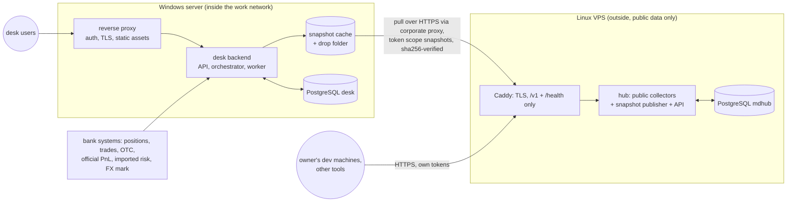

# 06 Deployment and operations

Decision: [ADR-001](adr/ADR-001-hosting-topology.md).
- The desk backend and frontend run on a **Windows server inside the work network**.
- The market-data hub runs as **one instance on a Linux VPS** and serves several consumers: the desk backend, the owner's development machines and other tools, each with its own token.
- Immutable snapshots are the only thing that crosses the boundary, and only inwards.

## 1 Topology

**Rules:**
- No private data on the VPS. Consumers only read from the hub; nothing is written to it from inside.
- The backend reads market data only from its snapshot cache, so a VPS or proxy outage never blocks a run. Snapshots already in the cache are used, and their age is shown.

## 2 Windows server layout (inside)

| Process | Runs as | Bind | Notes |
|---|---|---|---|
| Reverse proxy (IIS or Caddy) | Windows service | Internal HTTPS port | Authentication (Windows Integrated Authentication if allowed), TLS, static frontend assets, SSE without buffering |
| Desk backend API | Windows service (WinSW or NSSM wrapping Uvicorn) | localhost | FastAPI |
| Desk orchestrator and T2 worker | Windows service + Task Scheduler for the EOD and intraday triggers | — | One worker process with a process pool for valuation (Windows `spawn` start method) |
| Snapshot cache | Part of the backend worker | — | Pulls new snapshots from the VPS hub, verifies sha256 against the ID, stores the bundles; also ingests the drop folder |
| PostgreSQL 16 (Windows build) | Windows service | localhost | Database `desk` only |

**Python on Windows:** pinned to **3.11** (the version available on the work machine).
- Core requires ≥3.11, so it fits.
- The hub does not run on Windows, so its ≥3.12 requirement does not matter here.

**Sizing envelope** (to be measured): 4–8 cores, 16 GB RAM, SSD sized for snapshots and the desk database.

## 3 Linux VPS layout (outside)

**Deployed 18 October 2026**, hub 0.1.0. The address is not kept in the repository: each consumer sets it in its own settings (`DESK_HUB_URL` for the backend). The snapshot layer and consumer tokens are still to come ([VERTICAL_SLICES](VERTICAL_SLICES.md) S3, H1–H5).

- Reuse the hub's existing deploy (`market-data-server/deploy/README_DEPLOY.md`): docker compose (or systemd), PostgreSQL 16, Python 3.12, Caddy for TLS.
- Sizing: the deploy guide's minimum is 4 GB RAM and an 80 GB SSD. The seed database is already 3.4 GB, so leave headroom (8 GB RAM, 100 GB or more).
- Firewall: only 22 and 443 open (80 for the HTTP certificate challenge). PostgreSQL and the API bind to 127.0.0.1; Caddy proxies only `/v1/*` and `/health/*`.
- **Consumers and tokens.** One named token per consumer, with the narrowest scope (`snapshots` for the desk backend; `read` for development machines and analysis tools). Tokens are revocable in the admin console, and every request is logged per token.
- The admin console is reachable only through Caddy and the IP allow-list, with passkey or TOTP login.
- **Location.** Prefer a provider and region from which every public source answers. cbr.ru, Rosstat and MOEX restrict some foreign IP addresses at times, and Cbonds allow-lists client IPs. Check with the hub's source probes before restoring the seed.
- Backups of the VPS database go off the VPS (program ADR07, hub README_DEPLOY §7). `deploy/.env` is backed up separately, because it holds the key that opens the stored source credentials.

## 4 Which collector runs where

| Source kind | Where it enters |
|---|---|
| Public sources (MOEX ISS/APIM, CBR, ECB, Rosstat, Ratescalcs, OTC Monitor) | The VPS hub. It is the single authoritative location of every series it collects |
| Bank-internal sources (internal FX mark, internal market-data system, vendor feeds licensed to the bank network) | The desk backend's private-input adapters inside ([04](04_BACKEND.md)). They are versioned overrides on top of a hub snapshot and are never sent to the hub |
| Snapshot bundles copied by hand (fallback when the proxy blocks the VPS) | The backend's drop folder inside, with the same sha256 verification |

A run's lineage records the hub snapshot IDs and the override set version, so which data came from where is always visible.

## 5 Corporate proxy (open: Q4)

The backend's snapshot cache needs outbound HTTPS to the VPS hub through the proxy. Its behaviour is still unknown, so plan for:
- **TLS inspection.** Install the bank root CA into the service trust store (`SSL_CERT_FILE` / `REQUESTS_CA_BUNDLE`, or the httpx `verify` setting). **Never disable certificate verification.**
- **Proxy authentication.** NTLM/Kerberos may need a local helper (px, cntlm) or a service account allowlisted by host.
- **An allowlist request:** the VPS hub's hostname only.
- **A fallback.** A drop folder where an operator places snapshot bundles fetched elsewhere. They are ingested with the same verification, and staleness is shown in the UI.

## 6 Data licensing

All market data used is properly licensed (owner, 16 October 2026). Record each source's licence scope in the hub's source registry, and keep the authoritative source per series (DEC04). The hub serves several consumers, so tokens go only to the owner's own consumers within each source's licence scope.

## 7 Develop outside, run inside

| Rule | How |
|---|---|
| No real positions, results or internal files leave the network | Development uses public data and synthetic portfolios only |
| Fixtures are public or synthetic | A CI check rejects private identifiers (book names, counterparty names, internal IDs) in `fixtures/` and test data |
| Reproducible installs without internet | Build an offline **Windows wheelhouse for Python 3.11** outside (numpy and psycopg binary wheels included), transfer it with checksums, install pinned versions. Test on Windows before each release (program ADR08) |
| Versioned releases | Core released with tags; backend pins the exact core version; hub schema version pinned in the backend |
| Code transfer | Git bundle or internal mirror, plus a release archive with checksums |

## 8 Time

- Store instants as `timestamptz` in UTC. The business date is Moscow (UTC+3, no daylight saving).
- The Windows server clock and the VPS clock are both synchronised (NTP). Cut times are compared in UTC.
- **EOD cut:** which session close or mark defines EOD for bonds, curves and FX is decision DEC04. Until it is settled:
  - bonds use the MOEX main-session EOD (preliminary) and the next-morning final;
  - FX uses the internal 19:00 mark when supplied, otherwise it is labelled as a candidate;
  - CBR FX uses the effective date known at the cut.
- **Calendars:** the hub's calendars, including Russia's transferred working Saturdays, reach core only through the versioned calendar in the static snapshot.

## 9 Monitoring and alerting

The hub has quality checks and gap tracking but **no alerting** today. Add one notification channel (email or the bank messenger) for:

| Source | Alert |
|---|---|
| Hub (VPS) | Failed or missed job; dataset stale beyond policy; gap turned unfillable; snapshot not published at the cut; source probe failing; certificate expiry |
| Snapshot cache (inside) | Newest cached snapshot older than the cut plus a grace period; pull failing (proxy or token) |
| Backend | EOD or intraday run failed or incomplete; coverage below threshold; T+1 official not attached by a set time; PnL break above threshold (DEC12) |
| Servers | Disk usage, backup failure, certificate expiry, service down |

Health endpoints: hub `/health/ready`; backend `/health/ready` (database, latest cached snapshot age, worker heartbeat).

## 10 Backups and recovery

| Item | Method | Target |
|---|---|---|
| `desk` database (inside) | Nightly `pg_dump -Fc`, plus WAL archiving if RPO < 24 h is required | A backup location inside the bank, **not on the same disk** |
| Snapshot cache (inside) | Not backed up: it can be pulled again from the hub by ID. Snapshots used by official runs are kept for replay | — |
| VPS `mdhub` and raw archive | Nightly dump plus file sync with checksums; `deploy/.env` separately | Off the VPS |
| Configuration and secrets | Config in git; secrets in the approved secret store (Windows: DPAPI / Credential Manager or the bank's vault) | — |
| Drill | Quarterly restore to a clean environment, then verify run replay from a snapshot | Evidence recorded |

Initial goals carried from program ADR07: RPO 24 h, RTO 2 h. Confirm with the owner.

## 11 Security

- On the Windows server, services bind to localhost; only the reverse proxy listens on the network.
- Authentication and roles per [05](05_FRONTEND_INTEGRATION.md) §6.
- The hub and the desk have no shared database. The backend reads hub data only through its snapshot cache.
- The backend's hub token (scope `snapshots`) is kept in the secret store. Every other consumer of the hub has its own token.
- No secrets in repositories, URLs or logs. The hub already redacts secrets in logs and URLs; keep that behaviour.
