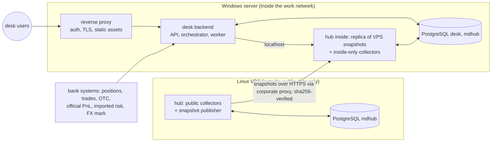

# 06 Deployment and operations

Decision: [ADR-001](adr/ADR-001-hosting-topology.md).
- The desk backend and frontend run on a **Windows server inside the work network**.
- The market-data hub may be **split between a Linux VPS outside and the Windows server inside**.
- Immutable snapshots are the only thing that crosses the boundary.

## 1 Topology

**Rules:**
- No private data on the VPS.
- The backend reads market data only from the inside endpoint, so a VPS or proxy outage never blocks a run. Snapshots already on the inside side are used, and their age is shown.

## 2 Windows server layout (inside)

| Process | Runs as | Bind | Notes |
|---|---|---|---|
| Reverse proxy (IIS or Caddy) | Windows service | Internal HTTPS port | Authentication (Windows Integrated Authentication if allowed), TLS, static frontend assets, SSE without buffering |
| Desk backend API | Windows service (WinSW or NSSM wrapping Uvicorn) | localhost | FastAPI |
| Desk orchestrator and T2 worker | Windows service + Task Scheduler for the EOD and intraday triggers | — | One worker process with a process pool for valuation (Windows `spawn` start method) |
| Hub inside (replica + inside-only collectors) | Windows service | localhost | Pulls VPS snapshots; collects only what must be collected inside |
| PostgreSQL 16 (Windows build) | Windows service | localhost | Databases `desk` and `mdhub`, separate roles, no cross-database joins |

**Python on Windows:** pinned to **3.11** (the version available on the work machine).
- Core requires ≥3.11, so it fits.
- The hub requires ≥3.12 today. Its Windows part must either lower the requirement to 3.11 or ship an embedded 3.12 runtime for its own service.

**Sizing envelope** (to be measured): 4–8 cores, 16 GB RAM, SSD sized for snapshots and the desk database.

## 3 Linux VPS layout (outside)

- Reuse the hub's existing deploy (`market-data-server/deploy/`): docker compose or systemd; PostgreSQL 16; API behind TLS; Python 3.12.
- The VPS exposes only the authenticated snapshot endpoints that the inside replica needs (list, manifest, bundle), plus health. One token per consumer.
- Backups of the VPS database and raw archive go off the VPS (program ADR07).

## 4 Which collector runs where

This is decided per source and is not final.

| Source kind | Default location |
|---|---|
| Public sources (MOEX ISS/APIM, CBR, ECB, Ratescalcs) | VPS, unless the corporate proxy allows them from inside, in which case either location works. Keep one authoritative location per series |
| Bank-internal sources (internal FX mark, internal market-data system, vendor feeds licensed to the bank network) | Inside |
| Manual file drops (fallback for any public source) | Inside |

Whichever instance collects a series publishes its snapshots. The inside replica merges VPS snapshots and inside-collected series into the snapshots the backend reads. Each series records its source and collecting location in the manifest.

## 5 Corporate proxy (open: Q4)

The inside replica, and any public collectors run inside, need outbound HTTPS through the proxy. Its behaviour is still unknown, so plan for:
- **TLS inspection.** Install the bank root CA into the service trust store (`SSL_CERT_FILE` / `REQUESTS_CA_BUNDLE`, or the httpx `verify` setting). **Never disable certificate verification.**
- **Proxy authentication.** NTLM/Kerberos may need a local helper (px, cntlm) or a service account allowlisted by host.
- **An allowlist request:** the VPS hostname, plus any public source hosts collected inside.
- **A fallback.** A drop folder where an operator places snapshot bundles or source files. They are ingested with the same verification, and staleness is shown in the UI.

## 6 Data licensing

All market data used is properly licensed (owner, 16 October 2026). Record each source's licence scope in the hub's source registry, and keep the authoritative source per series (DEC04).

## 7 Develop outside, run inside

| Rule | How |
|---|---|
| No real positions, results or internal files leave the network | Development uses public data and synthetic portfolios only |
| Fixtures are public or synthetic | A CI check rejects private identifiers (book names, counterparty names, internal IDs) in `fixtures/` and test data |
| Reproducible installs without internet | Build an offline **Windows wheelhouse for Python 3.11** outside (numpy and psycopg binary wheels included), transfer it with checksums, install pinned versions. Test on Windows before each release (program ADR08) |
| Versioned releases | Core released with tags; backend pins the exact core version; hub schema version pinned in the backend |
| Code transfer | Git bundle or internal mirror, plus a release archive with checksums |

## 8 Time

- Store instants as `timestamptz` in UTC. The business date is Moscow (UTC+3, no daylight saving).
- The Windows server clock and the VPS clock are both synchronised (NTP). Cut times are compared in UTC.
- **EOD cut:** which session close or mark defines EOD for bonds, curves and FX is decision DEC04. Until it is settled:
  - bonds use the MOEX main-session EOD (preliminary) and the next-morning final;
  - FX uses the internal 19:00 mark when supplied, otherwise it is labelled as a candidate;
  - CBR FX uses the effective date known at the cut.
- **Calendars:** the hub's calendars, including Russia's transferred working Saturdays, reach core only through the versioned calendar in the static snapshot.

## 9 Monitoring and alerting

The hub has quality checks and gap tracking but **no alerting** today. Add one notification channel (email or the bank messenger) for:

| Source | Alert |
|---|---|
| Hub (VPS and inside) | Failed or missed job; dataset stale beyond policy; gap turned unfillable; snapshot not published at the cut; **replica lagging the VPS** |
| Backend | EOD or intraday run failed or incomplete; coverage below threshold; T+1 official not attached by a set time; PnL break above threshold (DEC12) |
| Servers | Disk usage, backup failure, certificate expiry, service down |

Health endpoints: hub `/health/ready` on each instance; backend `/health/ready` (database, latest snapshot age, worker heartbeat).

## 10 Backups and recovery

| Item | Method | Target |
|---|---|---|
| `desk` database (inside) | Nightly `pg_dump -Fc`, plus WAL archiving if RPO < 24 h is required | A backup location inside the bank, **not on the same disk** |
| `mdhub` (inside replica) | Nightly dump; it can also be rebuilt from VPS snapshots | Same |
| VPS `mdhub` and raw archive | Nightly dump plus file sync with checksums | Off the VPS |
| Configuration and secrets | Config in git; secrets in the approved secret store (Windows: DPAPI / Credential Manager or the bank's vault) | — |
| Drill | Quarterly restore to a clean environment, then verify run replay from a snapshot | Evidence recorded |

Initial goals carried from program ADR07: RPO 24 h, RTO 2 h. Confirm with the owner.

## 11 Security

- On the Windows server, services bind to localhost; only the reverse proxy listens on the network.
- Authentication and roles per [05](05_FRONTEND_INTEGRATION.md) §6.
- Each service has its own database role: the hub cannot read `desk`, and the backend reads hub data only through the inside hub API or snapshot cache.
- The backend authenticates to the inside hub, and the inside replica to the VPS, each with its own bearer token, kept in the secret store.
- No secrets in repositories, URLs or logs. The hub already redacts secrets in logs and URLs; keep that behaviour.
