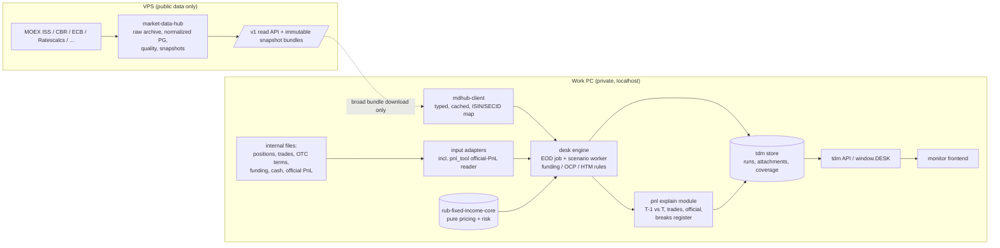

# Trading Desk Monitor: cross-module architecture review

> **Read first: owner corrections, 16 October 2026.** This review was written before the owner clarified the project's state, so read its integration findings in that light:
> - `pnl_tool` is a standalone tool, not designed to be integrated yet.
> - `prototypes/` are visual mockups of how the tool should look, not the working frontend.
> - The backend is mostly documents (contracts, conventions); `tdm/` is a prototype store.
> - No integration between components was expected at this stage.
>
> The owner also decided that all components run on one server inside the work network ([ADR-001](../adr/ADR-001-hosting-topology.md)). The findings on code quality and correctness (MD-*, CORE-*, BE-*, FE-*, PNL-*) remain valid as checklists. The architecture and plan sections are superseded by the documents in [docs/architecture/](../README.md).

16 October 2026. This review covers all five components as they exist on disk today:

| Component | Location | Revision reviewed |
|---|---|---|
| Frontend (monitor screens) | `trading_desk_monitor/prototypes/` | `3e4486a` (contract 1.3) |
| Backend store / API (`tdm`) | `trading_desk_monitor/tdm/` | `3e4486a` |
| Calculation library | `rub-fixed-income-core/` | `454a78c` (v0.6.0) |
| Market / static data service | `market-data-server/` (market-data-hub) | `74ed84f` (under active development) |
| PnL tool | `pnl_tool/` (no git) | v1.2 sources |

Method: a full source read of each module, the test suites run in scratch copies, and targeted probes. **No repository was modified.** The one exception is that the local `trading_desk_monitor` checkout was fast-forwarded to `origin` (it was two merge commits behind).

| Suite | Result |
|---|---|
| tdm | 53 pass, 1 skipped (jsonschema not installed) |
| core | 436 pass |
| market-data-hub | 451 pass |
| pnl_tool | 34 Python + 42 JS + 58 profiler, all pass |

This document complements, and does not replace, [EXECUTION_SPEC.md](../../program/EXECUTION_SPEC.md), [BASELINE_REVIEW.md](../../program/BASELINE_REVIEW.md) and [DECISIONS.md](../../program/DECISIONS.md).

---

## 1. Verdict in one page

**Each part is decent on its own, but the system as a whole does not exist yet.** No component calls any other:

- `tdm` does not import the core library.
- market-data-hub does not import it either.
- The core library's market-data bridge (`public_schedule.py`) targets the response format of the *old* market-data-store service. The new hub does not produce that format.
- The only real integration path is CSV files: the hub's TDM export feeds `tdm load`.
- The "EOD calculation" step in `daily.bat` is a comment telling a human to run it. The only implementation is `examples/calc_service_stub.py`, which replays demo JSON.

| Component | Maturity | One-line assessment |
|---|---|---|
| market-data-hub | **Most mature** | Raw-first, fails closed, never forward-fills, honest about gaps. 451 tests. Weak spots are consumer integration, point-in-time static data, alerting and backups. |
| rub-fixed-income-core | **Good kernel, narrow scope** | Pure, strictly typed, well-tested math for *fixed-coupon RUB bonds* and their rates/spread risk. No floaters, FX, swaps on positions, carry/roll, holiday calendars, market-snapshot or portfolio abstraction. |
| tdm (store + API) | **Good contract, weak time model** | Thorough versioned data contract and run lifecycle. It is a *results store plus backend-for-frontend*: it calculates no pricing or risk. Inputs are current-version only, published runs are mutated in place, and missing data becomes zero. |
| Frontend prototypes | **Feature-rich, untrustworthy numbers** | Five screens with a lot of functionality: a good functional spec. But PnL nulls become zeros differently on each screen, two break thresholds coexist, history is fabricated under filters, and partial scenario results are labelled "full revaluation". |
| PnL explain | **Does not exist** | `pnl_tool` is an *accounting-PnL analytics* tool for the official trade-level PnL report, not an explain engine. Core has a Taylor-vs-exact building block. Nothing computes carry, rolldown, new trades, funding or residual. |

**Your four-or-five-module picture is right**, with two corrections:

1. **The "backend calculation server" is the missing piece, not an existing one.** `tdm` is the backend's *storage and publication* layer. The engine that pulls market data, prices positions with core, applies desk rules and writes a run has to be built. It is the critical path.
2. **The PnL module should be a separate package inside the backend process, not a separate service.** It needs both days' positions, risks, market moves and trades, all of which live in the backend store. `pnl_tool` should become its official-PnL *input adapter*, not the module itself.

---

## 2. Target architecture

### Single owner per concept

Most of today's risk comes from several modules each half-implementing the same idea. Make ownership explicit:

| Concept | Owner | Everyone else |
|---|---|---|
| Public market and static data, raw history, revisions | market-data-hub | `tdm` keeps only the per-run snapshot it consumed (`mkt_*`). Retire `md_*` as a source of truth; at most it is a cache. |
| Immutable published snapshot (ID, manifest, cut, coverage) | market-data-hub | The desk engine pins `snapshot_id` in every run. |
| Curve *construction* (OFZ/ZCYC evaluation, RUONIA OIS, KEY) | **core** (code). The hub *may* run pinned core to publish built curves with a `build_id`. | `tdm` stops linearly interpolating its own pillars (`market.py:10`). The UI shows the curve the risk was computed on. |
| Pricing, risk, Hessian, exact repricing | core | The browser keeps the Taylor approximation for interactive what-ifs only, with a JS↔Python parity test. |
| Funding, OCP, HTM, dual FX (desk conventions) | desk engine (Python, one module) | Remove the duplicate JS implementation; the browser consumes published outputs. |
| Scenario definitions and results | desk engine + `tdm` (hash-pinned, with coverage) | |
| PnL explain and official reconciliation | pnl module in the desk backend | `writer.py` stays a sink. |
| Official PnL source parsing and revisions | pnl_tool reader/snapshot logic, extracted | `tdm.pnl_official` becomes append-only revisions. |
| Display aggregation (totals, breaks, coverage) | **`tdm` server** publishes aggregates and coverage | All screens use one shared JS selector module; no page re-derives totals. |

---

## 3. Module findings

Each finding is labelled with the module and a number, so tasks can cite it (for example "fix FE-1").

### 3.1 market-data-hub (VPS)

**Well done**
- `ops.raw_capture` archives every fetch (gzip, SHA-256, parser version), with lineage from normalized rows back to it.
- Prices are stored as `numeric`, with units in column names. A source-confirmed "no data" day is distinct from a gap.
- Idempotent upserts, per-job Postgres advisory locks, a token-bucket rate limit (ISS at 3 requests/s), and preliminary plus next-morning final runs.
- KBD/ZCYC publications are checked by re-deriving their yields.
- The TDM export matches contract 1.3 headers and units, including the yield basis for `md_curves` against `ytm`.
- Docker plus systemd deploy, bound to localhost, and a tested seed bundle/restore path.

**Problems (ranked)**

| # | Issue | Fix |
|---|---|---|
| MD-1 | **No hand-off to core.** No projected-cashflow endpoint, no curve-build IDs, no mapping to core's `SnapshotEvidence`. Core's bridge targets a deprecated service. | Add a resolved-schedule endpoint (or rewrite core's bridge against `/v1/bonds/{secid}`). Do it as one task spanning both repos, with a shared fixture. |
| MD-2 | **TDM export silently drops about 700 active bonds**: 668 with `coupon_type='unknown'`, plus perpetuals. Quotes are exported for bonds that are not exported. | Export them with an explicit flag. Perpetual maturity = call date (contract 1.3 added `call_date` for this). Filter quotes to exported instruments. |
| MD-3 | Floater benchmarks such as `RUONIA_3M` and `ZCYC` are passed through raw. **OFZ-IN is exported as `fix`.** | Map or withhold unresolvable floaters. Mark linkers as unsupported until CPI and indexation exist. |
| MD-4 | **Static data is exported "as of now"** even for past dates, which looks ahead. `row_history` exists for `ref.*` but has no as-of reader, and deletes are not versioned. | Add a `known_at` reader for static data and use it in the export. Version deletes too. |
| MD-5 | **No snapshot concept.** The spec's `/v1/snapshots/{id}/manifest|bundle` does not exist; `/v1/export/tdm` is generated on the fly. | Publish immutable daily snapshots (ID, cut, manifest, checksums, coverage) and have consumers pin the ID. |
| MD-6 | **No alerting and backups only on the VPS itself** (14 pg_dumps in `./backups`). | Telegram or email on failed or missed jobs, stale data and unfillable gaps. Off-site encrypted backup and a scheduled restore drill. |
| MD-7 | No value-level quality checks (spikes, cross-source CBR↔MOEX FX, RUONIA↔RUSFAR). | Add them after alerting. |
| MD-8 | A single shared token list, no per-consumer scopes, no API rate limit. Ratescalcs credentials are weak. | Per-consumer tokens with revocation; ask the provider to rotate Ratescalcs. |
| MD-9 | No typed client. | `mdhub-client` generated from OpenAPI. It must run on the work PC's Python. |

**Data gaps for a RUB fixed-income desk:**
- No built RUONIA/KEY curves, and no rule for which end-of-day snapshot counts.
- No repo by basket, no NCC haircuts, no Lombard list.
- No ratings: Cbonds returns 401.
- No CDS.
- No CPI.
- No SOFR, €STR or SARON (each has a free official API).
- No corporate-action or event feed (restructurings, exchanges).
- No 19:00 bond or curve snapshot to match the desk's FX cut.
- Intraday data is 15-minute delayed, and the API does not expose the intraday tables at all.

### 3.2 rub-fixed-income-core (library)

The reviewed package is 4,081 lines in 18 modules. The roughly 86k lines on disk are the untracked `audit/` (2.5 GB) and `implementation/` (596 MB) folders.

**Well done**
- Pure, I/O-free, frozen dataclasses with explicit convention objects.
- One bracketed bisection solver that refuses unbracketed or non-finite results; pervasive input validation.
- `mypy --strict` and ruff are clean.
- 11-bucket KRD identical to tdm's buckets; CS01 and OFZ-spread risk.
- A full 12×12 Hessian with stable numerics.
- A Taylor-vs-exact residual: the seed of PnL explain.
- Signed JTD with mandatory recovery.
- `local_worker` has the **right coverage semantics** (complete/partial/failed, null totals when incomplete). Copy that model into `tdm`.
- Unsupported products are explicitly rejected, never mispriced.

**Problems (ranked)**

| # | Issue | Fix |
|---|---|---|
| CORE-A | **Narrow product scope.** Fixed-coupon RUB bonds with caller-supplied cashflows only. No floaters, OFZ-IN, FX, seasoned swaps, repo, futures or CDS; KEYRATE support covers par quotes only. | Priority order: holiday calendar → fixing-aware floaters (RUONIA/KEY, lag, lookback) → seasoned OIS/KEY swaps → FX forwards → OFZ-IN → XCCY/CDS. |
| CORE-B | **`BusinessCalendar` is weekends-only** (`dates.py:32`). | Feed the MOEX/RU calendar from the hub with a version. This is a quiet source of wrong accrued interest, settlement and carry. |
| CORE-C | **No horizon valuation.** Scenarios are same-date only, so there is no carry, rolldown or theta, and no coupon/principal/accrued split (`BondCashflow` is just date + amount; `public_schedule.py:92` collapses the split). | Add "re-settle at T+1 with curve or spread held" valuation, and split cashflows. Both are prerequisites for PnL explain. |
| CORE-D | **No `MarketSnapshot` / `Position` abstractions.** Each `PublicBondSnapshot` carries its own full curve, so nothing is shared across positions. | A `MarketSnapshot` (curves by ID, FX, fixings, as-of, evidence) and a `Position` (book, category, currency). Add a thin adapter that emits tdm factors (`IR|curve|bucket`, `CS`, `FX|ccy`). |
| CORE-E | **Performance.** OIS-quote mode with Hessian takes about 500 ms per position, so roughly 8 minutes for 1,000 bonds, because each position re-bootstraps the same ~300 shocked curves. | Cache shocked curves by (curve, shock vector); expected gain is about 100×. Then a process pool. |
| CORE-F | **Possible convention error in the RUONIA OIS bootstrap.** The default is unadjusted annual ACT/365F with no spot or payment lag; audit F08 says MOEX uses TOM/MODFOL/ACT-ACT with a +1B payment lag. No ZCYC/NSS evaluator, so no G-spread, which tdm expects (`g_spread_bp`). | Add a versioned, spec-conformant OIS convention, an NSS evaluator and G-spread. |
| CORE-G | **No external golden tests.** Nothing checks against MOEX-published yields, accrued interest or durations. The "OFZ 26238 parity probe" release gate is not in the suite, and the bridge and fixing tests live in git-ignored folders. | Twelve or more OFZ/corporate golden cases (bullet, amortizer, put) from MOEX; move the bridge tests into `tests/`. |
| CORE-H | **API sprawl.** Three yield solvers, two Z-spread entry points, V1 vs V2 `analyze_bond` (about 16 bp apart under the same field name), dead `_price_at_yield`, `risk.py` reaching into private curve fields, hashing living in `analytics.py`. | A deprecation pass once tdm becomes a consumer. |
| CORE-I | **Repo hygiene.** The `.gitignore` change for `audit/` and `implementation/` is **uncommitted**, so a stray `git add .` could stage 3 GB of SQLite and cached sources. No tags after v0.3.0. A proprietary-system reconciliation probe ships in the sdist. Docs describe 0.3.x. | Commit the ignore, move the evidence folders to a sibling directory, tag 0.4–0.6, remove the probe from the package, refresh the docs. |

**Fitness verdict.** Core can supply roughly 30–40% of what tdm needs for a bond-only book today, and nothing yet for floaters, OTC or FX. Funding, FX, new trades and official PnL should stay **out** of core; audit F13 agrees.

### 3.3 tdm (backend store, API, publication)

**Well done**
- A thorough, versioned data contract (1.0→1.3) with additive migrations and validation at publish: issuers, FX, 11 buckets, gamma factors, POS/HTM linkage, DV01 consistency.
- Run lifecycle: loading → complete or failed. Per-run copies of reference and market tables.
- Standard library only, so it is easy to deploy on a locked-down Windows PC.
- WAL mode, read-only reader connections, a path-traversal-guarded static server.

**Problems (ranked).** All of these were verified, most with probes; B-numbers refer to [BASELINE_REVIEW.md](../../program/BASELINE_REVIEW.md), and **all of B01–B12 are still open**.

| # | Issue | Where |
|---|---|---|
| BE-1 | **It computes no prices or risk and has no job runner.** `scenario_job` exists in the schema, but no code reads or writes it. | `schema.sql:507`, `daily.bat` |
| BE-2 | **A TEST run becomes the default view** if it has a later `as_of`. | `assemble.py:20`, `histscen.py:76` |
| BE-3 | **`derive_funding` hides missing PnL.** It inserts funding-only `position_pnl` rows, so the "no PnL" warning never fires. A probe published 66 bonds with rates, spread and carry all zero and no warning. | `writer.py:469` vs `:592` |
| BE-4 | **Missing data becomes zero or a stale value with no flag:** `unexplained = 0` when official is missing; the "official" desk total falls back to explained + FX basis; any old fixing, CBR rate or cash snapshot is accepted; missing CBR falls back to market FX. | `assemble.py:141,168,100`, `writer.py:679`, `market.py:55,112` |
| BE-5 | **`fx_cbr_next` returns the first future row**, which could be months ahead (reproduced: 2027-03-01 for an as-of of 2026-10-13). | `market.py:99` (B08) |
| BE-6 | **The cache key uses `COUNT(*)`**, so replaced results with the same row count serve a stale body (reproduced). | `server.py:23` (B06) |
| BE-7 | **Runs are not reproducible.** Inputs are current-version upserts with no knowledge time or input hash. Official PnL and scenario results mutate published runs in place. Assembly reads *current* scenario definitions, meetings, instruments and quotes. | B02, B03, B05 |
| BE-8 | **Funding uses current MV; the base date and price are a convention to decide (DEC01), not current MV by default.** | `writer.py:440` (B01, DEC01) |
| BE-9 | **The server binds `0.0.0.0` with no auth.** The install guide tells users to open the firewall. | `cli.py:17`, `run.bat:12` (B12) |
| BE-10 | **Operational hazards:** • `purge` deletes old EOD runs by default. • `daily.bat` `move /y` overwrites same-named archived files. • Historical scenarios build *before* the EOD calc. • Naive local timestamps. • No log files. • Live-file copy offered as a backup method. | `cli.py:127`, `daily.bat` |

### 3.4 Frontend (prototypes)

**Well done**
- The breadth is real: Desk Monitor (8 tabs), Widget Board (15 widget types, cross-filter), Pivot Studio, Scenario & PnL Lab, and the Bonds view.
- PnL waterfall from market-FX flash to CBR basis to official; drill-down to positions; a carry and funding scenario builder.
- ECharts is bundled locally.
- **Treat these pages as the functional specification. They are the most valuable output of the project so far.**

**Problems (ranked)**

| # | Issue | Where |
|---|---|---|
| FE-1 | **Missing official PnL is treated as zero in at least six places, each differently.** On a partial T+1, the Desk Monitor KPI shows a fake break while the PnL tab shows none. Widget Board, Pivot and Scenario Lab never check `official.received`, so before T+1 Scenario Lab says "В допуске" (within tolerance). | `desk-monitor.html:605,1384,1420`, `widget-board.html:476`, `pivot-studio.html:424,695`, `scenario-lab.html:872` |
| FE-2 | **Two definitions of unexplained in one screen.** Past dates fold the CBR-vs-market FX basis into unexplained. | `scenario-lab.html:894` |
| FE-3 | **Two break-threshold policies:** 0.5m/2m RUB vs `max(2m, 5%·|official|)`. | `desk-monitor.html:1422-1427`, `scenario-lab.html:863` (DEC12) |
| FE-4 | **Fabricated history.** Under a filter, Widget Board scales desk history by the book's *current* share. Desk Monitor sparklines ignore filters. | `widget-board.html:467-469` |
| FE-5 | **A partial full revaluation is shown as "Полная переоценка" (full revaluation)**, because missing positions are zero-filled. | `desk-util.js:174` (B05) |
| FE-6 | **Silent defaults change results:** • spread defaults to 100 bp; • key rate and missing indices default to 0; • market FX is copied into CBR FX; • ofzSpr01 defaults to 0. | `desk-util.js:21-35,197,388,420` |
| FE-7 | **Aggregation drift across pages:** OCP derivative set; CDS notional in deal currency added to `mvRub`; Pivot's own funding-FX allocation. | `widget-board.html:381,390`, `desk-monitor.html:537,542`, `pivot-studio.html:404` |
| FE-8 | **Business logic duplicated in JS and Python** (Taylor engine, gamma summary, compat defaults, carry and funding) with no parity test. | `desk-util.js` vs `histscen.py`, `assemble.py` |
| FE-9 | **Scale.** At 10k positions `window.DESK` is 24 MB as a blocking script, the carry grid takes 3.8 s per filter click, and tables are not virtualised. | measured |
| FE-10 | **Corporate-network blockers:** Google Fonts on every page; absolute `/api/...` URL in the bond history call; no CSV/Excel export anywhere; no "newer run available" notice. | |

### 3.5 pnl_tool (local, no git)

**Well done.** The best data-integrity engineering in the project:
- SHA-256 idempotent imports.
- Snapshot-boundary revisions (date + entity + book) with explicit overlap policies, so rows removed by a correction disappear.
- No silent zeros; Decimal-exact storage.
- A row-level check that the total equals its P&L and OCI parts.
- A stdlib-only XLSX reader.
- A privacy-preserving report profiler.

**Problems**

| # | Issue |
|---|---|
| PNL-1 | **It is not PnL explain.** It works only on reported accounting PnL (total, P&L and OCI parts), with no positions, market data or risk. |
| PNL-2 | **"Official PnL" is undefined across modules.** pnl_tool holds trade-level *accounting* PnL keyed by trade id. tdm expects *management* PnL by position at CBR basis, including funding. Nobody has stated whether the official trade-level PnL report's daily total *is* `pnl_official`, whether its FX revaluation uses CBR rates, or whether it includes funding. **This blocks every reconciliation claim.** |
| PNL-3 | **No version control.** History exists only as zips in the project root. The code is audit-relevant. Keep the *data* local, but put the *code* in a local git repo with no remote; the existing `.gitignore` already excludes data. This needs your OK because `AGENTS.md` currently forbids it. |
| PNL-4 | Byte-identical `readers.py` in two places. Minified-style JS (lines up to about 3,000 characters). Hard-coded `/Users/...` path in `package_delivery.py`. Windows runtime never tested. No volume test of the single-HTML design. |

---

## 4. Cross-cutting problems

1. **Status drift in the plan.** `backlog.json` says 26 todo, 1 in progress. In reality:
   - market-data-hub has largely delivered DATA-01, DATA-02 and API-01, and partly OPS-01 (minus snapshots, auth scopes, alerting and off-site backup);
   - core has done AUDIT-01 and much of CORE-01/02;
   - EXPORT-01 is effectively done.

   Agents reading the backlog get the wrong picture. Reconcile it now and keep it current, or simplify it (see §7).
2. **The plan and the repos have diverged.** EXECUTION_SPEC §10 puts the market service under `services/market_data` and the local integration under `desk_backend` in *this* repo. In reality the hub is a separate repo on another account, and `desk_backend` does not exist. Update the spec to match reality.
3. **Two GitHub accounts and no CI anywhere.** Core and the hub are on FiveLimaGolf; tdm and the program are on FlyingScotman. That blocks cross-repo PRs, makes dependency pins fragile, and has already caused "repo inaccessible" situations (see STATUS.md). There is no `.github/workflows` in any repo.
4. **Python version mismatch:**

   | Component | Python |
   |---|---|
   | tdm | ≥3.9, stdlib only |
   | core | ≥3.11, with numpy |
   | hub | ≥3.12 |
   | pnl_tool | ≥3.10 |

   **The Python version on the work PC decides what is deployable.** Find it out now. The desk engine will need core, so it needs at least 3.11 plus numpy wheels on Windows, installed offline.
5. **Identifiers.** tdm keys on ISIN, core on SECID, and the hub on both. Its export uses ISIN only when unique, otherwise SECID. The official trade-level PnL report uses a trade id and a book. There is no mapping table anywhere. Make one canonical `instrument_id` rule and one ID map shipped with each snapshot.
6. **Missing vs zero is the dominant correctness bug class.** It shows up in tdm, the frontend, the desk-history fallback and scenario results. Only the hub and pnl_tool handle it well, and core's `local_worker` has the right `Coverage` model. **Adopt one coverage vocabulary end to end:** `measured`, `zero`, `missing`, `pending`, `stale`, `estimated`, `official`, `partial(n/N)`.
7. **Time model.** The hub is effectively bitemporal for market data, but not for static data. tdm has no knowledge time. The frontend has none. Replay of a past date (required for PnL explain and T+1) is impossible end to end until the hub's static data as-of reads (MD-4) and the run input pinning in tdm (BE-7) are both done.

---

## 5. What is missing from the plan or under-specified

These are features a working desk monitor needs that are absent, or only implied, in today's plan.

**Core desk workflow**
- **Position source and trade roll-forward.** Where do positions come from, and how are they reconciled to trades (T-1 position + trades = T position)? PnL explain needs new, closed and round-trip trades, and the plan assumes internal files without a reconciliation step.
- **Price source hierarchy and trader marks.** For illiquid bonds, define a fallback chain, for example `waprice` → admitted quote → market price 3 → curve + spread model → manual mark. Each step needs a label and an age, and stale marks need flags. The hub currently exports one basis, with no fallback (MD export issue 6).
- **Cash events on positions:** coupons, amortizations, offers exercised and defaults should flow into cash balances and PnL. Today they flow nowhere.
- **Intraday scope decision.** Everything is EOD. A desk *monitor* is usually expected to show at least an intraday PnL and risk refresh; the hub already has 15-minute-delayed bond and FX data. Decide: (a) EOD + T+1 only (current plan), or (b) an intraday "flash" run every N minutes using the same engine with an intraday snapshot. Option (b) mostly needs the engine to be fast (CORE-E) and the UI to poll for new runs.
- **Hedging and pre-trade tools**: what-if trades ("add 1bn of 26238"), hedge ratios against OFZ or RUONIA futures, rich/cheap relative to the fitted curve. The Bonds view already does part of the last one.

**Data**
- Curve-building ownership for RUB RUONIA and RUB KEY (nobody owns it; tdm historical scenarios need both).
- Repo rates by basket and haircuts (funding of the bond book).
- Ratings source: Cbonds 401. Ratings drive the rating-bucket spread shocks in the UI.
- CPI for OFZ-IN.
- A corporate-actions and events feed.

**Operations**
- One **orchestrator** on the work PC: load inputs → fetch snapshot → EOD calc → historical scenarios → publish → T+1 official attach. It should exit non-zero with a log on failure, and give **notifications** for failed runs, stale data and PnL breaks. Today this is a .bat file plus a human.
- **Alerting on the VPS** (MD-6).
- A **Windows packaging** strategy: offline wheelhouse, pinned Python, one installer for tdm + desk engine + core. Test it early: Linux success says nothing about the work PC.
- **Backup and restore of the work-PC SQLite** using `.backup`, not a file copy.

**Product**
- **Export** (CSV/Excel with `as_of` and `run_id` stamps) on every table. Middle office and management will ask for it on day one.
- A **daily report** (PDF or email) for management, generated from the published run.
- Server-side, **shareable user views** (pivot layouts, custom scenarios). Today they live in each browser's localStorage.
- **Limits and VaR** are explicitly excluded, which is reasonable for now. Leave room for them in the contract: risk users will ask, and pnl_tool already computes a historical VaR on reported PnL.

**Engineering**
- **CI** for all repos.
- A **shared synthetic desk fixture** that runs hub-export → tdm load → engine → UI as one end-to-end test.
- **Contract tests** between the hub export and the tdm loader, and between the core adapter and the hub API.

---

## 6. Recommended plan

The plan is ordered so that each phase leaves something working. Phases 1 and 2 can run in parallel; so can 4 and 5. Sizes are rough.

### Phase 0: housekeeping (about 1–2 days, mostly owner actions)

1. **Repository and account decision.** Consolidate core and market-data-hub under FlyingScotman (or one organisation) *before* tdm pins core. Add minimal CI (pytest + ruff) to each repo.
2. **Core:**
   - commit the `.gitignore`;
   - move `audit/` and `implementation/` to a sibling `rfic-evidence/` folder;
   - tag v0.4.0–v0.6.0;
   - remove the proprietary reconciliation probe from the package.
3. **pnl_tool:** decide on a local, no-remote git repo for the code (PNL-3).
4. **Find out the work-PC Python version and its proxy/HTTPS behaviour.** This gates the packaging plan.
5. **Reconcile `backlog.json`** with what is actually done, and update EXECUTION_SPEC §10 paths to the real repo layout.

### Phase 1: stop showing wrong numbers (tdm + frontend, about 1 week)

All local, no new architecture:
- BE-2: default to EOD runs only.
- BE-3: restore the missing-PnL warning.
- BE-5: `fx_cbr_next` must match the expected effective date.
- BE-6: revision-based cache key.
- BE-9: bind to `127.0.0.1` by default.
- BE-10: `purge` keeps EOD runs; date-stamped archive names; `.backup`.
- Staleness bounds on fixings, CBR rates, cash and curves.
- FE-1 to FE-5:
  - **the server publishes per-position and aggregate PnL with nulls and a coverage count**;
  - one shared `selectors.js` used by every screen;
  - one configurable threshold source;
  - remove the fabricated filtered history;
  - "full revaluation" only at 100% coverage.
- FE-6: every default carries a visible flag.
- FE-10: bundle the fonts locally; relative URLs.
- Add a fixture with **partial official PnL** and a **partial scenario result**, and run all five screens against it.

### Phase 2: R0 vertical slice (about 2–3 weeks)

**Goal:** one fixed-coupon OFZ book, synthetic positions, real hub data, priced by core, published by tdm and shown in the UI. Nothing hand-made in between.

1. **Hub:** an immutable daily snapshot with a manifest (MD-5); MD-2 export fixes; a resolved-schedule endpoint or bridge (MD-1).
2. **`mdhub-client`:** a small typed package, compatible with the work-PC Python, with on-disk caching and checksum verification.
3. **Core:** `MarketSnapshot`, `Position`, a holiday calendar from the hub (CORE-B), shocked-curve caching (CORE-E), the tdm-factor adapter, and MOEX golden tests (CORE-G).
4. **Desk engine** (new package `desk_engine/` in this repo, depending on a pinned core release):
   - input adapters;
   - snapshot fetch and pin;
   - pricing and risk via core;
   - funding, OCP and HTM rules moved here from `writer.py` (fix DEC01 here);
   - write through `tdm.writer.Run`;
   - record `snapshot_id`, core version and input hash in `calc_run`.
5. **Orchestrator** replacing `daily.bat` (load → engine → historical scenarios → publish), with logs and a non-zero exit on failure.
6. **End-to-end test** on the shared synthetic fixture, running in CI.

### Phase 3: PnL explain v1 (about 2–3 weeks; needs DEC05 and PNL-2 answered)

- **Core:** horizon valuation (carry and rolldown) and the coupon/principal/accrued cash split (CORE-C).
- **`pnl` package in the desk backend:**
  - reads runs T−1 and T, the trades and the cash events;
  - risk-based attribution in a **frozen order**: carry → rolldown → rates → spread → convexity/cross → FX → funding → new trades → residual;
  - a full-revaluation residual check using core's Taylor-vs-exact.
- **Official-PnL adapter:**
  - reuse pnl_tool's XLSX reader and its snapshot/revision logic;
  - a field map from the official trade-level PnL report to `pnl_official`;
  - a book/entity/position ID map;
  - **append-only revisions** (DEC11) in place of the current upsert.
- **Break register:** a threshold per book (DEC12), notes and revisions, displayed in the PnL tab.

### Phase 4: broaden coverage (ongoing)

- **Core:** floaters (RUONIA/KEY with lags) → seasoned OIS/KEY swaps → FX forwards → OFZ-IN → XCCY/CDS. Spec-conformant RUONIA OIS bootstrap and NSS/G-spread (CORE-F).
- **Hub:** point-in-time static data (MD-4); RUONIA and KEY curve builds with a `build_id`; repo by basket; ratings; CPI; alerting and off-site backups (MD-6).
- **tdm:** effective-dated terms and funding rules (B02); scenario jobs with a definition hash, coverage, cancellation and timeout (B05, B07).

### Phase 5: frontend consolidation (in parallel with Phase 4)

1. Extract shared modules: format, theme, data, selectors, charts. Add a Vite + TypeScript build with types generated from the contract.
2. Server-side pre-aggregated cubes; lazy position loading; a virtualised grid; CSV/Excel export everywhere; a "newer run available" notice.
3. Then migrate screen by screen to a framework. The reviewer's recommendation is **React + TypeScript + AG Grid (or TanStack Table) + ECharts**, starting with Desk Monitor and behind the same `/api` contract. No big-bang rewrite.
4. Playwright smoke tests per screen against the fixtures; a JS↔Python parity test for the interactive Taylor engine.

### Phase 6: operate

Windows installer with an offline wheelhouse; restore drills on both sides; alerting; daily management report; optional intraday flash runs; then limits or VaR if desired.

---

## 7. A note on process

EXECUTION_SPEC and the backlog are thorough. For a single-owner project working through coding agents, they are also heavy:

- 27 tasks with formal roles;
- a runtime Hermes curator agent with sandboxing requirements;
- a reviewer role for everything.

Meanwhile the actual integration glue, the desk engine, has not started. Recommendations:

- **Defer the Hermes runtime agent (AGENT-01/02) entirely** until deterministic ingestion, alerting and backups are boring. The hub already runs well without it.
- Keep `DECISIONS.md` (it is valuable) and the requirement IDs, but **drive work from the phases in §6.** Use a lightweight task list, kept current by whoever finishes the work in the same PR.
- Give each repo an up-to-date `STATUS.md` and make the program `STATUS.md` link to them, instead of duplicating state.

---

## 8. Decisions needed from you

Existing DEC01–DEC12 stand. DEC05 (attribution), DEC01 (funding base), DEC04 (market cut) and DEC12 (thresholds) are on the critical path for Phases 2–3. New ones raised by this review:

| ID | Question | Blocks |
|---|---|---|
| A1 | Consolidate core and market-data-hub under the FlyingScotman account or an organisation? When? | Pinning core in tdm, CI |
| A2 | Work-PC Python version, and can numpy wheels be installed offline? | Desk engine packaging |
| A3 | Is the official trade-level PnL report (its daily total) the official PnL, or is there a separate management PnL? CBR basis? Includes funding? | PnL reconciliation (PNL-2) |
| A4 | EOD-only, or intraday flash runs as well? | Engine performance target, UI polling |
| A5 | Who builds RUONIA/KEY curves: core in the engine, or the hub publishing builds made with pinned core? | Historical scenarios, swap risk |
| A6 | Price hierarchy for illiquid bonds, and are trader manual marks allowed? | Valuation, PnL |
| A7 | Local git for pnl_tool code (no remote)? | Code provenance |
| A8 | Frontend: incremental TypeScript/React migration after Phase 1, or stay vanilla? | Phase 5 |
| A9 | Defer the Hermes runtime agent until after R1? | Plan scope |
